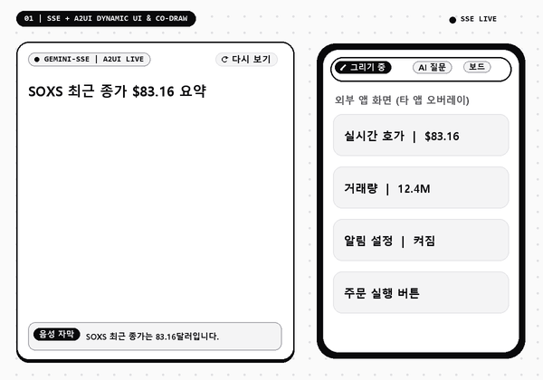
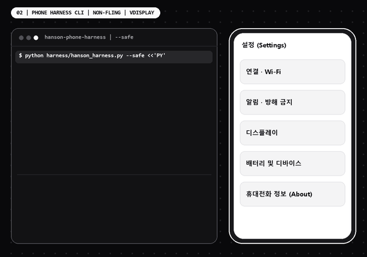
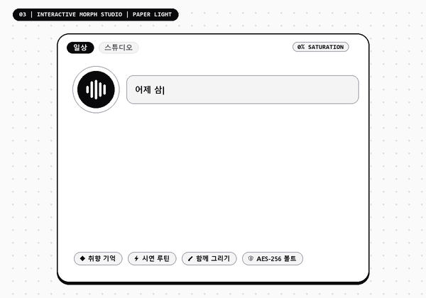
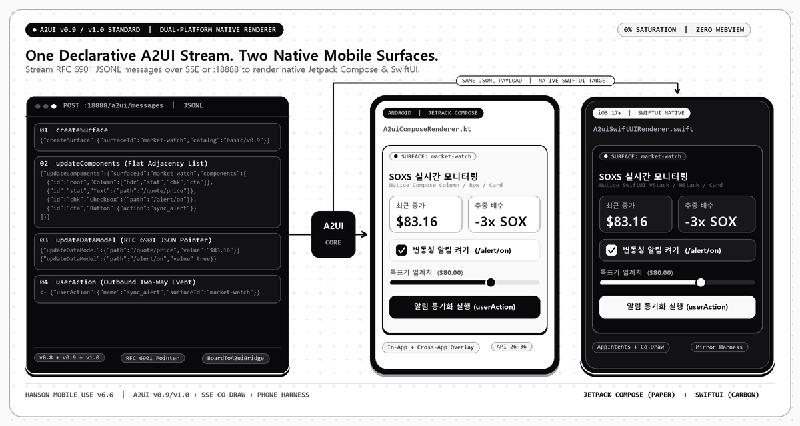
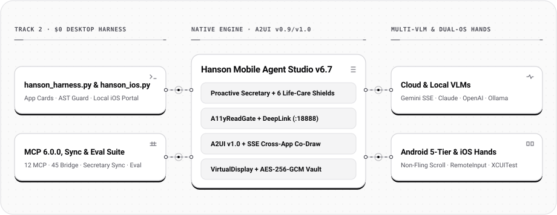
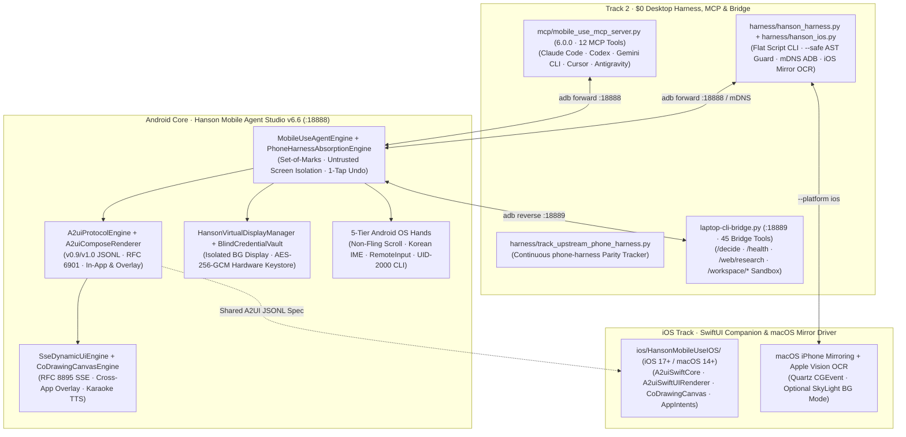

<div align="center">

<picture>
  <source media="(prefers-color-scheme: dark)" srcset="assets/hero-dark.svg" />
  <source media="(prefers-color-scheme: light)" srcset="assets/hero-light.svg" />
  
</picture>

<br /><br />

<p align="center">
  <a href="../../releases">
    <picture>
      <source media="(prefers-color-scheme: dark)" srcset="assets/cta-download-dark.svg" />
      <source media="(prefers-color-scheme: light)" srcset="assets/cta-download-light.svg" />
      
    </picture>
  </a>&nbsp;
  <a href="docs/studio-preview.html">
    <picture>
      <source media="(prefers-color-scheme: dark)" srcset="assets/cta-preview-dark.svg" />
      <source media="(prefers-color-scheme: light)" srcset="assets/cta-preview-light.svg" />
      
    </picture>
  </a>&nbsp;
  <a href="#phone-harness-cli">
    <picture>
      <source media="(prefers-color-scheme: dark)" srcset="assets/cta-harness-dark.svg" />
      <source media="(prefers-color-scheme: light)" srcset="assets/cta-harness-light.svg" />
      
    </picture>
  </a>&nbsp;
  <a href="#a2ui-architecture">
    <picture>
      <source media="(prefers-color-scheme: dark)" srcset="assets/cta-arch-dark.svg" />
      <source media="(prefers-color-scheme: light)" srcset="assets/cta-arch-light.svg" />
      
    </picture>
  </a>
</p>

<p align="center">
  <a href="LICENSE"></a>
  <a href="docs/A2UI_SPEC_INTEGRATION.md"></a>
  <a href="ios/README.md"></a>
  <a href="harness/SKILL.md"></a>
  <a href="mcp/README.md"></a>
</p>

**Open-Source Human-First Mobile Companion, A2UI v0.9/v1.0 Dual-Platform Native Renderer, & Composable Phone Harness**  
*안드로이드·iOS 양대 플랫폼 A2UI v0.9/v1.0 네이티브 렌더링 · 단일 스크립트 Phone Harness CLI & 백그라운드 `VirtualDisplay` · 앱 내·외부 SSE 실시간 Dynamic UI & 공동 드로잉 · AES-256-GCM Blind Vault · $0 MCP / 멀티 VLM 브리지*

</div>

---

## Live Motion Showcase

<table>
  <thead>
    <tr>
      <th align="center" width="33.3%">⚡ SSE + A2UI &amp; Co-Draw</th>
      <th align="center" width="33.3%">🦾 Phone Harness CLI &amp; VirtualDisplay</th>
      <th align="center" width="33.3%">✦ Morph Studio &amp; Paper/Carbon</th>
    </tr>
  </thead>
  <tbody>
    <tr>
      <td align="center">
        
      </td>
      <td align="center">
        
      </td>
      <td align="center">
        
      </td>
    </tr>
    <tr>
      <td>Real-time <b>Gemini SSE + A2UI</b> streaming cards, interactive quizzes, synchronized voice captions, and floating cross-app <b>Human + AI Co-Drawing</b> overlays.</td>
      <td>Single-heredoc <b><code>hanson_harness.py --safe</code></b> CLI with fail-closed AST guard, <b>200ms brake-hold non-fling scroll</b>, banking denylist preflight, and background <b><code>VirtualDisplay</code></b>.</td>
      <td>Natural language morphed directly into interactive <b>Split-Bill / Storyboard / Curator</b> UI with <b>1-Tap Undo</b> and strictly <b>0%-saturation Paper &amp; Carbon</b> themes.</td>
    </tr>
  </tbody>
</table>

---

<a id="a2ui-architecture"></a>
## A2UI v0.9 / v1.0 Cross-Platform Native Surfaces

Hanson Mobile-Use v6.6 implements Google's declarative **[A2UI (Agent-to-User Interface)](https://a2ui.org/)** wire protocol (`v0.9` / `v1.0` primary with `v0.8` backward compatibility) natively on **both Android Jetpack Compose and iOS SwiftUI** — zero WebView bloat, zero chromatic drift, strictly adhering to Hanson's 0%-saturation **Obsidian Paper (`#FAFAFA / #09090B`) & Carbon (`#09090B / #FAFAFA`)** tokens.

<div align="center">
  
</div>

- **Canonical Streaming Engine ([`A2uiProtocolEngine.kt`](app/src/main/java/com/hanson/mobileuse/agent/A2uiProtocolEngine.kt))**: Parses streaming JSONL / SSE envelopes (`createSurface`, `updateComponents`, `updateDataModel`, `deleteSurface`, plus v0.8 `surfaceUpdate` / `dataModelUpdate` / `beginRendering`), resolves **RFC 6901 JSON Pointer** bindings (`@path`, `path`, `${/ptr}`, `@{/ptr}`) with two-way input state mutations, emits outbound `A2uiUserAction` events, and bridges Hanson's `BoardEventScript` via `BoardToA2uiBridge`.
- **Native Android Compose Renderer ([`A2uiComposeRenderer.kt`](app/src/main/java/com/hanson/mobileuse/ui/components/A2uiComposeRenderer.kt))**: Maps the A2UI Basic Catalog (`Column`, `Row`, `List`, `Card`, `Box`, `Text`, `Button`, `TextField`, `CheckBox`, `MultipleChoice` / `ChoicePicker`, `Slider`, `Divider`, `Icon`, `Image`) directly onto Obsidian Compose primitives (`A2uiSurfaceCard` / `A2uiSurfaceDeck`) — rendered live **both inside Command Center AND floating over third-party Android apps** via `DynamicCanvasOverlayService`, served over token-authenticated `POST :18888/a2ui/messages` & `GET :18888/a2ui/surfaces` and advertised in `/.well-known/agent-card.json`.
- **Native iOS SwiftUI Companion ([`ios/HansonMobileUseIOS/`](ios/HansonMobileUseIOS/))**: Compile-ready Swift 5.9+ Package (`iOS 17+` / `macOS 14+`) mirroring the exact A2UI JSONL core ([`A2uiSwiftCore.swift`](ios/HansonMobileUseIOS/Sources/HansonMobileUseIOS/A2uiSwiftCore.swift)), SwiftUI Basic Catalog renderer ([`A2uiSwiftUIRenderer.swift`](ios/HansonMobileUseIOS/Sources/HansonMobileUseIOS/A2uiSwiftUIRenderer.swift)), normalized `0..1` SwiftUI `Canvas` co-drawing ([`CoDrawingSwiftUICanvas.swift`](ios/HansonMobileUseIOS/Sources/HansonMobileUseIOS/CoDrawingSwiftUICanvas.swift)), RFC 8895 SSE + `AppIntents` Shortcuts bridge ([`HansonSseAndAppIntents.swift`](ios/HansonMobileUseIOS/Sources/HansonMobileUseIOS/HansonSseAndAppIntents.swift)), and unit tests ([`HansonMobileUseIOSTests.swift`](ios/HansonMobileUseIOS/Tests/HansonMobileUseIOSTests/HansonMobileUseIOSTests.swift)).
- **Protocol Spec & Tests**: [`docs/A2UI_SPEC_INTEGRATION.md`](docs/A2UI_SPEC_INTEGRATION.md) · [`A2uiProtocolEngineTest.kt`](app/src/test/java/com/hanson/mobileuse/agent/A2uiProtocolEngineTest.kt).

---

## System Architecture

<div align="center">
  <picture>
    <source media="(prefers-color-scheme: dark)" srcset="assets/architecture-dark.svg" />
    <source media="(prefers-color-scheme: light)" srcset="assets/architecture-light.svg" />
    
  </picture>
</div>

<details>
<summary><b>Expand Detailed Pipeline &amp; Mermaid Topology</b></summary>

```text
Natural Language + Memory Bubbles + A2UI / SSE Stream
  → Interactive Morph UI & Native A2UI Surfaces (Android Compose + iOS SwiftUI)
    → Observe (Set-of-Marks [0..N] / Apple Vision OCR + Contextor + <untrusted_screen_data> Isolation)
      → Align & Decide (D-Artemis TAC+ACA · Auto | Plan | Build · On-Phone VLM OR $0 Desktop CLI / MCP)
        → Guard (AST Script Guard · Banking Preflight · Financial Gate · Non-Bypass CAPTCHA/2FA · Blind Vault)
          → Act (Index Tap · 200ms Non-Fling Scroll · Blind Vault Inject · VirtualDisplay · iOS Mirror CGEvent)
            → Verify Post-Action Delta + 1-Tap Reversible Receipt + Offline HTML Trace Replay
```



Deep dives: [`docs/ARCHITECTURE.md`](docs/ARCHITECTURE.md) · [`docs/SSE_DYNAMIC_UI_AND_CODRAW_ARCHITECTURE.md`](docs/SSE_DYNAMIC_UI_AND_CODRAW_ARCHITECTURE.md) · [`docs/A2UI_SPEC_INTEGRATION.md`](docs/A2UI_SPEC_INTEGRATION.md) · [`docs/MOBILE_AGENT_REVERSE_ENGINEERING_2026.md`](docs/MOBILE_AGENT_REVERSE_ENGINEERING_2026.md) · [`docs/UPSTREAM_PHONE_HARNESS_TRACKER.md`](docs/UPSTREAM_PHONE_HARNESS_TRACKER.md).

</details>

---

## Real Hardware & Consumer Onboarding Gallery

<table>
  <thead>
    <tr>
      <th align="center" width="50%">Real Hardware Capture · Galaxy S25 (Android 16)</th>
      <th align="center" width="50%">10-Second Zero-Jargon 3-Step Onboarding</th>
    </tr>
  </thead>
  <tbody>
    <tr>
      <td align="center">
        
      </td>
      <td align="center">
        
      </td>
    </tr>
    <tr>
      <td align="center">Live <b>Paper Light</b> home on physical Android 16 hardware with calm contextual focus deck, quick-pill dock, and zero developer clutter.</td>
      <td align="center">Guided <b>3-step setup</b>: instant taste bubbles → 1-tap free key / $0 local CLI bridge / offline mode → optional accessibility &amp; overlay permissions.</td>
    </tr>
  </tbody>
</table>

---

## Android & iOS Dual-Platform Capability Matrix

Hanson is strictly honest about OS sandbox boundaries rather than faking unsupported behavior. Full iOS engineering notes live in [`ios/README.md`](ios/README.md), and live upstream parity against [`phone-harness/phone-harness`](https://github.com/phone-harness/phone-harness) (`22/25` transport ops = `88.0%`, `38` flat script helpers) is continuously tracked in [`docs/UPSTREAM_PHONE_HARNESS_TRACKER.md`](docs/UPSTREAM_PHONE_HARNESS_TRACKER.md).

| Capability | Android (`app/` + `hanson_harness.py`) | iOS (`ios/HansonMobileUseIOS/` + `hanson_ios.py`) |
|---|---|---|
| **A2UI v0.9 / v1.0 Native Rendering** | **Full** — `A2uiComposeRenderer.kt` (in-app **and** cross-app floating overlay) | **Full (In-App)** — `A2uiSwiftUIRenderer.swift` (`iOS 17+` / `macOS 14+` SwiftUI) |
| **SSE Dynamic UI & Co-Drawing** | **Full** — in-app + cross-app `SYSTEM_ALERT_WINDOW` passthrough canvas | **Full (In-App)** — `CoDrawingSwiftUICanvas.swift` + RFC 8895 SSE client |
| **Zero-Jailbreak Cross-App Control** | **Full** — `:18888` Accessibility + Set-of-Marks + mDNS ADB fallback | **Full via macOS** — `hanson_ios.py` (`iPhone Mirroring` + Apple Vision OCR + Quartz/SkyLight CGEvents) |
| **Non-Fling Precision Scrolling** | **Full** — 200ms brake-hold chained `StrokeDescription` (`/scroll_no_fling`) | **Full via macOS** — zero-fling pixel wheel scroll in `HansonIosMirrorClient` |
| **Korean / Unicode Input** | **Full** — native `ACTION_SET_TEXT` + clipboard paste fallback | **Full via macOS** — clipboard paste & keystroke injection via Mirroring |
| **Background Execution / VirtualDisplay** | **Full** — isolated `HansonVirtualDisplayManager` (`cacheDir` only) | **Full via macOS** — `HANSON_IOS_BACKGROUND=1` (`CGWindowListCreateImage` + SkyLight post) |
| **On-Device Cross-App Overlay & A11y Tree** | **Full** — `AccessibilityService` + `RemoteInput` screen-off reply | **Honest iOS Sandbox Limit** — forbidden without jailbreak; use `AppIntents` Shortcuts on-device or `hanson_ios.py` on macOS |
| **Safety & Preflight Gates** | **Full** — `--safe` AST guard, banking denylist, `<untrusted_screen_data>`, AES-256-GCM Blind Vault | **Full** — `--safe` AST guard, financial preflight, honest `UnsupportedIosOperationError` for `back`/`list_apps`/`tree` |

---

<a id="phone-harness-cli"></a>
## Quick Start

### Option A: Composable Phone Harness CLI (Android & iOS · Zero `pip install`)

Requires only **Python 3.9+** (standard library only). Drive multi-step phone scripts in a single heredoc with pre-imported flat helpers (`screen()`, `tap_text()`, `tap_ui()`, `type_text()`, `scroll()`, `scroll_until()`, `scroll_collect()`, `wait_for_text()`, `wait_stable()`, `preflight()`, `push_board_event()`, `codraw_ring()`, `vdisplay_start()`). See [`harness/SKILL.md`](harness/SKILL.md).

```bash
# Android (prefers <50ms native :18888 Accessibility + Korean IME, falls back to mDNS wireless ADB)
python -B harness/hanson_harness.py --safe --platform android <<'PY'
assert preflight()["safe"]
open_app("Settings")
scroll("down", amount=0.55)          # 200ms brake-hold non-fling scroll
tap_text("About phone")
codraw_ring(0.50, 0.44, "CHECK")     # live floating spotlight ring
PY

# iOS on macOS (zero-jailbreak iPhone Mirroring + Apple Vision OCR)
python -B harness/hanson_harness.py --safe --platform ios <<'PY'
assert preflight()["safe"]
print(screen())                      # Apple Vision OCR boxes (source="pixels")
scroll("down", amount=0.45)
PY

# Continuous upstream parity tracker against phone-harness/phone-harness
python -B harness/track_upstream_phone_harness.py --write-doc

# Replay any AgentRunJournal trace as an XSS-escaped offline monochrome HTML report
python -B harness/hanson_trace_viewer.py trace.json -o trace-report.html
```

---

### Option B: Zero-Extra-API-Cost MCP Server (`Claude Code` / `Codex` / `Gemini CLI`)

Zero external Python dependencies (`SERVER_VERSION = "6.0.0"`, stable **12 MCP tools** with `0`-based `element_index` and shell-safe pure-ADB fallback). See [`mcp/README.md`](mcp/README.md).

```bash
./gradlew installDebug
adb forward tcp:18888 tcp:18888
export ARTEMIS_TOKEN="<64-hex token from the app's Inspector / Bridge tab>"

# Register with your coding agent
claude mcp add android-mobile-use -e ARTEMIS_TOKEN="$ARTEMIS_TOKEN" -- python /path/to/hanson-mobile-use/mcp/mobile_use_mcp_server.py
codex  mcp add android-mobile-use -- python /path/to/hanson-mobile-use/mcp/mobile_use_mcp_server.py
gemini mcp add android-mobile-use    python /path/to/hanson-mobile-use/mcp/mobile_use_mcp_server.py
```

---

### Option C: Standalone Signed Release APK (3-Step Guided Setup) & Laptop Bridge (`:18889`)

1. **Install Release APK**: Download `hanson-mobile-use-v6.6.0-release.apk` from [GitHub Releases](../../releases) (or run `./gradlew assembleDebug`) on Android 8.0–16 (API 26–36). Release builds enforce `BuildConfig.GEMINI_API_KEY = ""`.
2. **Finish 3-Step Onboarding (10 Seconds)**: Pick starter preference bubbles → connect a free Google AI Studio key (`AQ.` or `AIza`, encrypted in on-device AES-256-GCM `BlindCredentialVault`), point to local **Ollama / vLLM**, or skip to offline Morph mode → enable Accessibility / Overlay / Notification Reply only when needed.
3. **Optional Laptop CLI & Sandboxed Workspace Bridge (`:18889`, `6.0.0`, `45 VALID_TOOLS` + `/web/research`)**:
   ```bash
   adb reverse tcp:18889 tcp:18889
   python -B laptop-cli-bridge.py --backend auto --workspace-root ./agent_workspace
   ```
   *(Read-only diagnostics by default; pass `--allow-workspace-exec` only to opt into sandboxed commands, and `--token <secret>` to require constant-time `X-Bridge-Token` auth.)*
4. **Interactive Web Preview**: Open [`docs/studio-preview.html`](docs/studio-preview.html) directly in any browser to test the living-presence hero, 3-step onboarding wizard, Morph UI cards, and Paper/Carbon switching without installing an APK.

---

## Core Tool Suite (`45` On-Device · `45` Bridge · `12` MCP)

| Category | Tools (`ToolSpecRegistry.kt` — 45 Specs) | Highlights |
|---|---|---|
| **Grounded GUI Control** | `click`, `long_press`, `input_text`, `swipe`, `drag_and_drop`, `haptic_trajectory`, `click_sequence`, `press_key`, `manage_app`, `open_link`, `wait_for_delay` | Set-of-Marks `[element_index]`, `0..1000` normalized coords, Korean/Unicode `ACTION_SET_TEXT` + clipboard paste, 200ms non-fling scrolling |
| **Screen-Off Messaging** | `list_notifications`, `reply_notification` | Sub-200ms background reply via Android `RemoteInput` tokens without waking the screen |
| **OS Fast-Lane & UARP** | `control_device_setting`, `make_call`, `send_sms`, `search_contacts`, `manage_calendar`, `set_alarm`, `save_note`, `read_note`, `os_cli_exec`, `reverse_engineer_app`, `learn_app_skill` | Direct brightness/volume/DND/telephony/PIM APIs, `UID-2000` helper daemon (`:18890`), and UARP deep-link skill distillation |
| **A2UI, SSE, & Media** | `render_generative_ui`, `browser_use`, `cross_device_control`, `draw_with_code`, `generate_visual_media` | A2UI v0.9/v1.0 native Compose/SwiftUI streaming (`:18888/a2ui/*`), cross-app Co-Draw overlay (`:18888/sse/board`), headless `BG` DOM reader |
| **Workspace Sandbox** | `workspace_list`, `workspace_read`, `workspace_write`, `workspace_edit`, `workspace_search`, `workspace_exec` | Canonical path-sandboxed file I/O, LCS unified diff, search, and read-only default diagnostics |
| **Blind Vault & SOTA** | `vault_blind_inject`, `vault_list_handles`, `watcher_manage`, `a2a_negotiate_schedule`, `scratchpad_note` | AES-256-GCM handle-based credential injection (raw secrets redacted & blocked from CLI fallback), background UI watchers, A2A negotiation |
| **Task Lifecycle** | `ask_user`, `complete_task` | Post-action delta verification, 1-tap reversible receipts, financial/price-drift approval, & non-bypassable `AWAITING_TAKEOVER` |

---

## Security & Verification

- **Hardened Loopback RPC & Bridge (`:18888` / `:18889` / `:18890`)**: Constant-time 256-bit `X-Artemis-Token` auth (`MessageDigest.isEqual`), wildcard CORS & DNS-rebinding rejection, `android:allowBackup="false"`, `usesCleartextTraffic="false"` + loopback-only `network_security_config.xml`, and `0600` shared-secret + `/proc/net/tcp` UID verification on `:18890`.
- **Prompt-Injection Isolation, AST Guard & Banking Preflight**: `UntrustedScreenDataGuard` wraps third-party UI trees in `<untrusted_screen_data>` with indirect prompt-injection signal detection; `hanson_script_guard.py` (`--safe`) fail-closes unsafe Python scripts via AST classification; `/preflight` blocks Korean & global banking/wallet/password apps.
- **AES-256-GCM Blind Vault & Non-Bypassable Takeover**: `BlindCredentialVault` isolates secrets in `AndroidKeyStore` (hardware IV + PBKDF2-HMAC-SHA256 `210,000`-iteration JVM fallback) and blocks raw secret reflection; `FinancialAndTakeoverGuard` halts cleanly into `AWAITING_TAKEOVER` on CAPTCHA / Turnstile / 2FA / secure keypads.
- **Zero-Key Release & Full Verification Suite (`32 suites / 549 Android tests + 16 Python harness tests`, 0 failures)**: Read [`SECURITY.md`](SECURITY.md) before exposing any port beyond `127.0.0.1`.

```bash
# Run Android unit & security hardening suites (32 suites / 549 Android tests, including A2uiProtocolEngineTest & PureAchromaticDesignTest)
./gradlew testDebugUnitTest assembleDebug

# Run Python harness, iOS driver, AST guard, & upstream tracker unit tests (16 Python harness tests, zero __pycache__)
python -B harness/test_hanson_harness.py
python -B harness/test_ios_and_tracker.py
```

---

## Key Documentation & Resources

| Resource | Path |
|---|---|
| **A2UI v0.9/v1.0 Spec Integration** | [`docs/A2UI_SPEC_INTEGRATION.md`](docs/A2UI_SPEC_INTEGRATION.md) |
| **iOS Companion & Mirror Architecture** | [`ios/README.md`](ios/README.md) · [`ios/HansonMobileUseIOS/Package.swift`](ios/HansonMobileUseIOS/Package.swift) |
| **Composable Phone Harness Skill** | [`harness/SKILL.md`](harness/SKILL.md) · [`harness/hanson_harness.py`](harness/hanson_harness.py) · [`harness/hanson_ios.py`](harness/hanson_ios.py) |
| **Upstream `phone-harness` Parity Tracker** | [`docs/UPSTREAM_PHONE_HARNESS_TRACKER.md`](docs/UPSTREAM_PHONE_HARNESS_TRACKER.md) · [`harness/track_upstream_phone_harness.py`](harness/track_upstream_phone_harness.py) |
| **SSE Dynamic UI & Co-Draw Architecture** | [`docs/SSE_DYNAMIC_UI_AND_CODRAW_ARCHITECTURE.md`](docs/SSE_DYNAMIC_UI_AND_CODRAW_ARCHITECTURE.md) |
| **Interactive Web Studio Preview** | [`docs/studio-preview.html`](docs/studio-preview.html) |
| **Core Architecture & 2026 SOTA Notes** | [`docs/ARCHITECTURE.md`](docs/ARCHITECTURE.md) · [`docs/MOBILE_AGENT_REVERSE_ENGINEERING_2026.md`](docs/MOBILE_AGENT_REVERSE_ENGINEERING_2026.md) |
| **MCP Server · Security · Contributing** | [`mcp/README.md`](mcp/README.md) · [`SECURITY.md`](SECURITY.md) · [`CONTRIBUTING.md`](CONTRIBUTING.md) |

---

## License

Released under the [MIT License](LICENSE).
