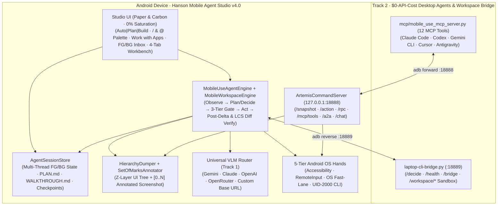

# Hanson Mobile-Use — Mobile Agent Studio v6.2

> **The Open-Source Android Human-First Companion & Mobile Agent Studio ("Natural Language → Interactive UI + Motion Moat + 3-Step 10-Second Consumer Onboarding + Full-Control Android Engine")**  
> **안드로이드 기기 완전제어 오픈소스 엔진 · 모바일 에이전트 스튜디오 v6.2 — 3단계 10초 일반 사용자 온보딩(`ConsumerOnboardingWizard`) + Flagship Figma 모션 UI + 자연어→인터랙티브 UI 변형 엔진(`InteractiveMorphEngine`) + 일상 컴패니언(`HumanFirstConvenienceEngine`: 기억 방울 · 1탭 되돌리기 · 시연 루틴 · D-Artemis TAC+ACA 정렬) + 선택형 BYO Cloud Firestore 동기화 + Blind Vault(AES-256-GCM) + 보안 하드닝 + $0 MCP / 멀티 VLM 브리지**

[](LICENSE)
[](#)
[](docs/studio-preview.html)
[](mcp/README.md)

**Hanson Mobile-Use (Mobile Agent Studio v6.2)** turns any physical Android phone or emulator into a verifiable, security-hardened **Human-First Mobile Companion** and **Mobile Agent Studio**. Anyone can launch the signed Release APK and finish setup in **3 effortless, jargon-free steps** (zero permissions required for instant interactive cards), turning natural-language goals into **direct-manipulation interactive UI surfaces & playable motion storyboards (`InteractiveMorphEngine`)**, backed by empirical Set-of-Marks closed-loop execution, D-Artemis (`TAC+ACA`) pre-execution alignment, `BlindCredentialVault` (AES-256-GCM), non-bypassable human takeover guards, and optional BYO Cloud Firestore cross-device sync:

```text
Natural Language + Memory Bubbles
  → Interactive Morph UI & Motion Storyboard (Direct Manipulation: Steppers, Option Cards, Route Scrubbing)
    → Observe (Set-of-Marks [0..N] + Contextor Outline + Notetaker Scratchpad + @vault/@notes/@watchers)
      → Align & Decide (D-Artemis TAC+ACA · Auto | Plan | Build · On-Phone VLM OR $0-Cost Desktop CLI / MCP)
        → Guard (Financial/Price-Drift Gate · Non-Bypass CAPTCHA/2FA AWAITING_TAKEOVER · Blind Vault)
          → Act (Index Tap / Gesture / Blind Credential Injection / OS Fast-Lane / Workspace Edit)
            → Verify Post-Action Delta + Deterministic Input Check + 1-Tap Reversible Receipt
```

- Interactive Flagship Motion Web Preview: [`docs/studio-preview.html`](docs/studio-preview.html) (390×844 mobile viewport · Paper Light / Carbon Dark toggle · Playable Motion Storyboard & Live Morph Engine)
- Architecture Deep Dive: [`docs/ARCHITECTURE.md`](docs/ARCHITECTURE.md)
- 2025–2026 SOTA Absorption Matrix: [`docs/MOBILE_AGENT_REVERSE_ENGINEERING_2026.md`](docs/MOBILE_AGENT_REVERSE_ENGINEERING_2026.md)
- Security Policy & Threat Model: [`SECURITY.md`](SECURITY.md)

---

## What's New in Mobile Agent Studio v6.2 & v6.1

1. **v6.2 AI-Native Architecture Modernization, Ahaboard-Style Structured Board UI, Natural TTS & Signed Release (`RichAnswerBoardFormatter` + `AhaboardResponseCard` + `ConsumerOnboardingWizard` + `LiveVoiceSessionManager`)**:
   - **Native 2026 Web Grounding & Text-First Q&A (Zero HTML Scraping)**: Deleted the legacy `html.duckduckgo.com` OkHttp scraper & XSS board; general/web queries route directly to **Gemini `google_search` + `url_context` (`gemini-3.8-flash` / `gemini-3.5-flash-lite`)**, **OpenAI `/v1/responses` (`web_search_preview`)**, **Anthropic (`web_search_20250305`)**, or the **`$0` Laptop CLI Bridge (`POST :18889/web/research`)** with full support for both new **`AQ.`** and legacy **`AIza`** Google AI Studio keys.
   - **Ahaboard-Style Visual Board UI & Markdown-Free Natural TTS**: [`RichAnswerBoardFormatter.kt`](app/src/main/java/com/hanson/mobileuse/agent/RichAnswerBoardFormatter.kt) + [`AhaboardResponseCard.kt`](app/src/main/java/com/hanson/mobileuse/ui/components/AhaboardResponseCard.kt) decompose LLM responses into animated highlight-swipe headlines, metric stat pills, numbered `Key takeaways` cards with bold-lead typography, and clean domain citation pills (zero raw `**` asterisks or raw redirect URLs), while normalizing spoken Korean TTS (`$83.16` → `"83.16달러"`, zero `"별표별표"`).
   - **Real Gemini Live API v1beta WebSocket Voice & Full Tool Calling Parity**: Upgraded [`LiveVoiceSessionManager.kt`](app/src/main/java/com/hanson/mobileuse/agent/LiveVoiceSessionManager.kt) to `BidiGenerateContent` v1beta WebSocket + `AudioRecord`(AEC/NS)/`AudioTrack` with permission-guarded fallback; fixed `BlindCredentialVault` AndroidKeyStore IV persistence, `429` vs `402` rate-limit handling, lowercase JSON Schema emission for Anthropic/OpenAI/MCP, `element_index`→`0..1000` coordinate resolution, `TYPE_APPLICATION` + Region occlusion filtering in `HierarchyDumper`, and deleted `~5,000` lines of dead `paradigm/` engines, orphan UI composables, and brittle regex hijackers.
   - **3-Step Zero-Jargon First-Run Wizard, Android 16 System Bars & Key-Safe Signed Release**: 10-second consumer onboarding (`ConsumerOnboardingWizard`), Paper Light / Carbon Dark `WindowInsetsController` contrast sync (`Theme.kt`), and `buildTypes.release` `BuildConfig.GEMINI_API_KEY = ""` isolation guard (`0` key hits verified across Release APK DEX).
2. **v6.1 Flagship Figma Motion UI & Natural Language → Interactive UI Moat (`InteractiveMorphEngine` + `HumanFirstCompanionCards`)**:
   - **Calm Ambient Living Home**: Replaces vertical multi-card walls with a Figma-designed `LivingPresenceHeroStage` (breathing halo, orbital satellite, 5-bar waveform), single-focus `ContextualFocusDeckCard`, floating `DynamicExecutionIslandBanner`, `FloatingOneTapUndoPill`, `FlagshipQuickPillDock`, and on-demand `CompanionDrawerBottomSheet` (`ModalBottomSheet`).
   - **`InteractiveMorphEngine`**: Explicit opt-in interactive morph cards (`SPLIT_BILL` live stepper + 100-won rounding, `FOOD_CURATOR`, `TIMELINE_PLANNER`, `MEDIA_STORYBOARD` interactive route canvas, `CALL_CONCIERGE`) and XSS-hardened achromatic `grayscale(100%)` micro-apps.
3. **v6.0 Human-First Convenience & Optional BYO Cloud Firestore Sync (`HumanFirstConvenienceEngine` + `HansonFirestoreCloudSyncEngine` + `firestore.rules`)**:
   - **Dual-Mode UX (`SIMPLE_HUMAN` | `STUDIO_PRO`)**: Zero developer jargon on primary screens, with 1-tap switching into full Studio Pro coding workbench.
   - **Transparent `HumanMemoryBubblesStore`, `PersonalRoutineStore` ("Show-Me-Once"), `ProactiveDailyBriefEngine`, `ReversibleReceiptPlanner` (1-Tap Undo), `CallConciergePlanner`, & Advisory `ArtemisDeliberativeAligner`**.
   - **BYO Cloud Firestore Sync**: Runtime `FirebaseOptions` with zero bundled credentials; syncs sanitized bubbles/routines/watchers/receipts (LWW merge) under strict owner-only `firestore.rules` while unconditionally denying `/users/{userId}/vault/**`.
4. **v5.0 Safety, Blind Vault & Pre-Release Security Hardening (`PickleSotaAbsorptionEngine` + `SECURITY.md`)**:
   - **`BlindCredentialVault` (AES-256-GCM Zero-Plaintext Separation)**: Encrypts user credentials & Cloud VLM API keys via `AndroidKeyStore` (hardware-generated IV + PBKDF2-HMAC-SHA256 `210,000`-iteration JVM fallback), handle-bound AAD, zeroed buffers, and SHA-256 hash-chained audit logs.
   - **Full-Stack Security Hardening**: `android:allowBackup="false"`, `usesCleartextTraffic="false"` + loopback-only `network_security_config.xml`, `x-goog-api-key` header transport, explicit user confirmation for external intents & fail-closed approvals, origin-locked `HansonWebViewClient` across all WebViews, CSRF/DNS-rebinding protection on `:18889`, and shell-quoted ADB fallbacks in MCP `6.0.0`.
5. **45 On-Device Tool Specs, `:18889` Bridge (`45` Tools + `/web/research`, `6.0.0`) & MCP `6.0.0` (`12` Tools)**:
   - [`ToolSpecRegistry.kt`](app/src/main/java/com/hanson/mobileuse/agent/ToolSpecRegistry.kt) maintains **45 tools** (with both Gemini ProtoJSON and standard lowercase JSON Schema emitters), [`AgentSessionStore.kt`](app/src/main/java/com/hanson/mobileuse/workspace/AgentSessionStore.kt) maintains **13 `/` slash commands**, [`laptop-cli-bridge.py`](laptop-cli-bridge.py) serves `6.0.0` with **45 `VALID_TOOLS`** + `POST /web/research`, and [`mcp/mobile_use_mcp_server.py`](mcp/mobile_use_mcp_server.py) serves `SERVER_VERSION = "6.0.0"` with its stable **12-tool** (`0`-based `element_index`) contract.

---

## Core Architecture Pillars

1. **Set-of-Marks (`[index]`) Visual + Structural Grounding (`SetOfMarksAnnotator`)**:
   Every interactive UI node across multi-window Z-layers (`AccessibilityService.getWindows()`) is stamped directly onto the screenshot with high-contrast `[0]`, `[1]`, `[2]` badges alongside normalized `0..1000` coordinates and editability/scrollability flags. Small VLMs and frontier models alike click exact `[index]` targets without coordinate hallucination.
2. **Empirical Post-Action Delta Verification (`MobileUseAgentEngine`)**:
   Actions never assume success. After every `click`, `input_text`, `swipe`, or `manage_app`, the engine captures a post-action snapshot, measures structural UI change, detects popups/IME state, and blocks premature `complete_task` calls until the user's goal is actually reflected on screen.
3. **Two-Track Brain Architecture (Standalone Phone OR $0-API-Cost CLI/MCP)**:
   - **Track 1 — Standalone On-Phone Universal VLM**: Bring your own key (`Gemini`, `Anthropic Claude`, `OpenAI`, `OpenRouter`) or point `Custom OpenAI-Compatible Base URL` to local **Ollama / vLLM / LM Studio / Groq / Together** with a built-in **1-Tap Connection Health Check**.
   - **Track 2 — $0-Extra-API-Cost MCP Server & CLI Subscription Bridge**:
     - **[`mcp/mobile_use_mcp_server.py`](mcp/mobile_use_mcp_server.py)** (`6.0.0`): Zero-dependency Python 3.9+ stdlib MCP server keeping all **12 MCP tools** (`0`-based `element_index`) intact with shell-safe ADB fallbacks and Studio v6.0/v6.1 workflow instructions for **Claude Code (`claude`), OpenAI Codex (`codex`), Gemini CLI (`gemini`), Cursor, and Antigravity**.
     - **[`laptop-cli-bridge.py`](laptop-cli-bridge.py)** (`6.0.0`): Local HTTP `:18889` bridge (`adb reverse tcp:18889 tcp:18889`) with CSRF/DNS-rebinding protection and optional `X-Bridge-Token` auth, delegating multi-step GUI reasoning to your desktop `claude` / `codex` / `gemini` CLI login and serving sandboxed `/workspace/*` routes (`--workspace-root`).
4. **5-Tier Unrestricted Android OS Execution**:
   - **Tier 1 (GUI & Accessibility)**: Multi-window Z-layer dump, hardware-buffer atomic screenshots, gesture bursts, IME-safe Unicode/Korean text injection (`ACTION_SET_TEXT` + clipboard fallback).
   - **Tier 2 (Screen-Off Notification `RemoteInput` & Live HUD)**: Replies to KakaoTalk, SMS, Telegram, Slack, and Discord notifications in `<200ms` without turning on the screen or opening the app, plus a touch-pass-through floating HUD (`SYSTEM_ALERT_WINDOW`).
   - **Tier 3 & 4 (OS Fast-Lane)**: `<30ms` direct intents and APIs for alarms, timers, hardware flashlight, brightness, media/ring/alarm volume, DND, calendar, contacts, calls, SMS, and `QUERY_ALL_PACKAGES` app launch.
   - **Tier 5 (Hardened Loopback RPC & A2A `:18888` + UID-2000 Binder CLI `:18890`)**: Constant-time 256-bit token auth (`X-Artemis-Token`), MCP tool schema export, Agent2Agent (`/a2a`) JSON-RPC 2.0, and foreground/background (`FG`/`BG`) dual-lane execution.

---

## Architecture Overview



See [`docs/ARCHITECTURE.md`](docs/ARCHITECTURE.md) for a deep dive into the empirical loop, Studio v5.0 & Pickle SOTA subsystems, `:18889` workspace sandbox routes, and security boundaries.

---

## Quick Start (빠른 시작)

### Option A: Use with Claude Code / Codex / Gemini CLI via MCP (Zero Extra API Cost)

Requires only **Python 3.9+** (standard library only — zero `pip install`) and `adb`.

```bash
# 1. Build & install the debug APK onto your connected Android device
./gradlew installDebug

# 2. Forward the on-device RPC server (or let the MCP server run adb forward automatically)
adb forward tcp:18888 tcp:18888
export ARTEMIS_TOKEN="<64-hex token shown in the app's Inspector/Bridge tab>"
```

Register the MCP server in one command:

```bash
# Claude Code
claude mcp add android-mobile-use -e ARTEMIS_TOKEN="$ARTEMIS_TOKEN" -- python /path/to/hanson-mobile-use/mcp/mobile_use_mcp_server.py

# OpenAI Codex CLI
codex mcp add android-mobile-use -- python /path/to/hanson-mobile-use/mcp/mobile_use_mcp_server.py

# Gemini CLI
gemini mcp add android-mobile-use python /path/to/hanson-mobile-use/mcp/mobile_use_mcp_server.py
```

*(Even without the app installed, `mcp/mobile_use_mcp_server.py` automatically falls back to pure `adb shell uiautomator` + `screencap` + `input`! See [`mcp/README.md`](mcp/README.md) for all 12 MCP tools.)*

---

### Option B: Standalone On-Phone Agent Studio (3-Step Guided Setup — Signed APK or Build)

1. **Install Signed Release APK & Launch**:
   - Download `hanson-mobile-use-v6.2.0-release.apk` from [GitHub Releases](../../releases) (or build `./gradlew assembleDebug`) and install on Android 8.0+ (API 26–36).
2. **Finish the Built-In 3-Step Consumer Onboarding Wizard (10 Seconds)**:
   - **Step 1 (Instant Taste Setup)**: Pick starter preference bubbles — zero permissions required to immediately try interactive Split-Bill, Menu, and Storyboard cards.
   - **Step 2 (Connect AI Brain)**: Tap **1-Tap Google AI Studio Free Key** + paste + **Test Connection (`연결 테스트`)**, **OR** pick **$0 Local CLI Bridge (`:18889`) / Ollama / vLLM URL**, **OR** skip to try offline first. Keys are encrypted inside on-device AES-256-GCM `BlindCredentialVault`.
   - **Step 3 (Optional Phone-Control Permissions)**: Enable **Accessibility Service** (includes an expandable Android 13+ *"Allow restricted settings / 제한된 설정 허용"* tip), **Floating Mini Bar (Overlay)**, and **Screen-Off Notification Reply** only when you want cross-app automation.
   - Power users can also inject keys from PC over USB:
     ```powershell
     $env:GEMINI_API_KEY="your-key"
     .\inject-adb.ps1 -TestPrompt "/plan 오전 9시 알람 맞춰줘"
     ```

---

### Option C: Phone Studio Powered by Your Laptop's CLI & Workspace Bridge (`:18889`)

Want to drive the phone from your laptop's logged-in `claude`, `codex`, or `gemini` CLI **and** let the mobile agent read/edit/diff/search a sandboxed project folder on your laptop?

```bash
adb reverse tcp:18889 tcp:18889
python laptop-cli-bridge.py --backend auto --workspace-root ./agent_workspace
```

- **Read-Only Safe Diagnostics by Default**: `--allow-workspace-exec` defaults to `False`, restricting `/workspace/exec` to read-only diagnostics (`ls`, `dir`, `pwd`, `cat`, `type`, `head`, `tail`, `wc`, `findstr`, `grep`, `python --version`, `pytest --version`, `git status`, `git diff`) with shell chaining (`&&`, `||`, `;`, `|`, `>`, `<`, `$`, `` ` ``) and path traversal rejected with `HTTP 403`.
- **Full Sandbox Execution (Opt-In)**: Pass `--allow-workspace-exec` only when you explicitly want non-chained commands executed with `cwd=WORKSPACE_ROOT`.
- **Bridge v6.0 Capabilities (`28` `VALID_TOOLS`)**: `GET /health` reports `version: "6.0.0"` and `valid_tools_count: 28`, while `GET /pickle/capabilities` exposes bridged SOTA tool parity (`validToolsCount: 28`). Pass `--token <secret>` (or `HANSON_BRIDGE_TOKEN`) to enforce constant-time `X-Bridge-Token` auth; browser cross-origin and non-loopback `Host` requests are rejected with `HTTP 403`.

---

## Core Tool Suite (`ToolSpecRegistry` — 42 On-Device Specs)

| Category | Tools | Highlights |
|---|---|---|
| **Grounded GUI Control** | `click`, `long_press`, `input_text`, `swipe`, `drag_and_drop`, `haptic_trajectory`, `click_sequence`, `press_key`, `manage_app`, `open_link`, `wait_for_delay` | `[element_index]` Set-of-Marks targeting, `0..1000` normalized coordinates, Korean/Unicode `ACTION_SET_TEXT` + clipboard paste + `IME_ACTION_SEARCH` |
| **Screen-Off Messaging** | `list_notifications`, `reply_notification` | Sub-200ms background reply via Android `RemoteInput` tokens without waking the screen |
| **OS Fast-Lane & UARP** | `control_device_setting`, `make_call`, `send_sms`, `search_contacts`, `manage_calendar`, `set_alarm`, `save_note`, `read_note`, `os_cli_exec`, `reverse_engineer_app`, `learn_app_skill` | Direct hardware brightness/volume/DND, telephony/PIM, `UID-2000` `hanson` OS CLI, and UARP manifest/deep-link skill distillation |
| **Omni-Nexus & Media** | `render_generative_ui`, `browser_use`, `cross_device_control`, `draw_with_code`, `generate_visual_media` | Headless background DOM reader (`BG` lane), `:18889` PC sync, HTTP IoT/smart-home nodes, on-demand interactive HTML5/SVG/GLB mini-apps |
| **Workspace Sandbox (v4.0+)** | `workspace_list`, `workspace_read`, `workspace_write`, `workspace_edit`, `workspace_search`, `workspace_exec` | Canonical path-sandboxed file I/O, LCS unified diff generation, `path:line: content` search, and read-only diagnostic/workspace execution |
| **Pickle Blind Vault & SOTA (v5.0)** | `vault_blind_inject`, `vault_list_handles`, `watcher_manage`, `a2a_negotiate_schedule`, `scratchpad_note` | AES-256-GCM handle-based credential injection (raw secrets redacted & blocked from CLI fallback), proactive background UI watchers, Pickle A2A schedule negotiation, and persistent session scratchpad notes |
| **Task Lifecycle** | `ask_user`, `complete_task` | Postcondition-guarded completion, financial/price-drift 1-shot approval, & non-bypassable `AWAITING_TAKEOVER` |

*(The external stdio MCP server [`mcp/mobile_use_mcp_server.py`](mcp/mobile_use_mcp_server.py) preserves its **12 core MCP tools** contract for external coding agents at `SERVER_VERSION = "6.0.0"`.)*

---

## Security & Privacy Highlights

- **Loopback-Bound + 256-Bit Constant-Time Token Auth**: `ArtemisCommandServer` (`127.0.0.1:18888`) requires `X-Artemis-Token` (or `Authorization: Bearer`) compared via `MessageDigest.isEqual`, blocks wildcard CORS, and forces token verification whenever proxy/tunnel/browser headers (`Origin`, `Referer`, `X-Forwarded-For`, `CF-Connecting-IP`) are present.
- **Canonical Workspace Sandbox (`MobileWorkspaceEngine` & `:18889`)**: Both on-device `resolveSafePath` and desktop `_resolve_workspace_path` enforce canonical containment inside `WORKSPACE_ROOT`, rejecting absolute paths, drive qualifiers, `..` traversal, symlink escapes, and prefix sibling collisions (`HTTP 403` / `SecurityException`). `/health` exposes only a safe non-PII `workspace_root` basename.
- **AES-256-GCM Blind Vault & Non-Bypassable Safety Guardrails (`PickleSotaAbsorptionEngine`)**: `BlindCredentialVault` injects secrets by handle without exposing raw values to LLM prompts (`redactSensitiveText`) and blocks `execOsCliFallback("text ...")` during `"vault_blind_inject"` recovery. `FinancialAndTakeoverGuard` enforces non-bypassable `AWAITING_TAKEOVER` on CAPTCHA/Turnstile/2FA/secure keypads and requires mandatory 1-shot user approval on financial or price-drift actions even in autonomous mode.
- **Zero Arbitrary Shell on `:18890` & Secure-by-Default `:18889`**: The `UID 2000` helper daemon verifies a `0600` shared secret token + `/proc/net/tcp` caller UID, while `laptop-cli-bridge.py` disables unrestricted `/workspace/exec` unless `--allow-workspace-exec` is explicitly passed.
- **Self-Click & Credential Guardrails**: The router and harness filter out Hanson's own window elements during multi-step tasks and never store API keys or `.jks` keystores in source control.
- Read [`SECURITY.md`](SECURITY.md) before exposing any port outside `127.0.0.1`.

---

## Interactive Studio Preview & Build from Source

- Open [`docs/studio-preview.html`](docs/studio-preview.html) directly in any desktop/mobile browser to test all Studio v6.2 Flagship Motion, 3-Step Consumer Onboarding, & Companion flows interactively (`LivingPresenceHeroStage`, 3-step `시작 가이드` wizard, live `InteractiveMorphEngine` Split-Bill/Menu/Storyboard/Call synthesis, On-Demand Companion Sheet, 1-Tap Undo, `Auto | Plan | Build`, 13 `/` commands, 4-tab Pickle Hub modal, and Paper/Carbon theme switching).

```bash
# Run the full unit & security hardening suite (28 suites / 531 tests) + build the debug APK
./gradlew testDebugUnitTest assembleDebug
```

- Signed Release APK: available on [GitHub Releases (`v6.2.0`)](../../releases) (`BuildConfig.GEMINI_API_KEY=""` enforced in `release` builds)
- Interactive Studio v6.2 Flagship Motion & Onboarding preview: [`docs/studio-preview.html`](docs/studio-preview.html)
- 2026 SOTA Reverse Engineering notes: [`docs/MOBILE_AGENT_REVERSE_ENGINEERING_2026.md`](docs/MOBILE_AGENT_REVERSE_ENGINEERING_2026.md)
- MCP Server docs: [`mcp/README.md`](mcp/README.md)
- Architecture guide: [`docs/ARCHITECTURE.md`](docs/ARCHITECTURE.md)
- Contributing guide: [`CONTRIBUTING.md`](CONTRIBUTING.md)

---

## License

Released under the [MIT License](LICENSE).
