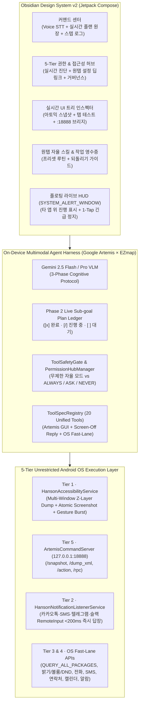

# Hanson × Google Artemis Mobile-Use AI (Android)

[](LICENSE)
[](#)
[](#)

**Hanson Mobile-Use AI**는 Google의 오픈소스 모바일 에이전트 하네스(`google/artemis` · `third_party/mobile_use` · `artemis-accessibility-helper`)와 **EZmap**의 온디바이스 멀티모달 거버넌스·음성·리버서빌리티 아키텍처, 그리고 **Screen-Off Notification `RemoteInput` 0.2초 즉시 답장 엔진**을 하나로 결합한 **무제한 자율 안드로이드 모바일 유즈(Mobile-Use) 오픈소스 앱**입니다.

Google Play 스토어의 정책 제약(`QUERY_ALL_PACKAGES`, `BIND_ACCESSIBILITY_SERVICE`, `BIND_NOTIFICATION_LISTENER_SERVICE`, `SYSTEM_ALERT_WINDOW`, `WRITE_SETTINGS`, `CALL_PHONE`, `SEND_SMS` 등)에 얽매이지 않고 안드로이드 OS가 제공하는 모든 권한과 제어 계층을 100% 활용할 수 있도록 설계되었습니다.

---

## 핵심 아키텍처 (Architecture Overview)



---

## 5-Tier 안드로이드 전권한 및 접근성 제어 매트릭스

| 티어 | 권한 / 서비스 | 핵심 기능 및 OS API |
|---|---|---|
| **Tier 1 · 접근성 및 GUI 엔진** | `BIND_ACCESSIBILITY_SERVICE` | `getWindows()` Z-레이어 멀티윈도우 탐색, API 33+ `FLAG_PREFETCH_DESCENDANTS_HYBRID`, 스크롤 컨테이너 클리핑, `takeScreenshot()` 하드웨어 버퍼 아토믹 캡처, `dispatchGesture()` 정밀 제스처 및 연속 탭 버스트(`click_sequence`), 전역 하드웨어 키(`HOME`, `BACK`, `RECENTS`, `NOTIFICATIONS`, `QUICK_SETTINGS`, `LOCK_SCREEN`) |
| **Tier 2 · 백그라운드 & 오버레이** | `BIND_NOTIFICATION_LISTENER_SERVICE`<br>`SYSTEM_ALERT_WINDOW`<br>`FOREGROUND_SERVICE_SPECIAL_USE`<br>`REQUEST_IGNORE_BATTERY_OPTIMIZATIONS` | 화면을 켜지 않고 카카오톡·SMS·텔레그램·슬랙 알림을 가로채어 `RemoteInput` 토큰으로 0.2초 내 백그라운드 답장 전송, 타 앱 위 드래그형 플로팅 라이브 HUD 오버레이, Doze 면역 상시 데몬 |
| **Tier 3 · OS 시스템 & 패키지** | `QUERY_ALL_PACKAGES`<br>`WRITE_SETTINGS`<br>`ACCESS_NOTIFICATION_POLICY`<br>`PACKAGE_USAGE_STATS` | 기기에 설치된 모든 앱 이름·패키지 무제한 탐색 및 실행, 시스템 화면 밝기(0~255), 미디어/벨소리/알람 볼륨, 방해금지 모드(DND) 즉시 제어 |
| **Tier 4 · 센서 & 커뮤니케이션** | `RECORD_AUDIO`, `CAMERA`, `ACCESS_FINE_LOCATION`, `CALL_PHONE`, `SEND_SMS`, `READ_CONTACTS`, `WRITE_CALENDAR`, `SET_ALARM` | 한국어 음성 인식(STT) 명령, 다이얼 화면 없이 즉시 전화 발신(`ACTION_CALL`), 백그라운드 SMS 전송(`SmsManager`), 연락처 검색, 캘린더 일정 및 알람 등록 |
| **Tier 5 · 루프백 RPC 브리지** | `127.0.0.1:18888` (`ArtemisCommandServer`) | 외부 `google/artemis` Python 에이전트, ADB, Termux, 로컬 MCP 서버가 `/snapshot`, `/dump_xml`, `/action`, `/rpc` 엔드포인트로 즉시 제어 가능 |

---

## 통합 20종 에이전트 도구 (`ToolSpecRegistry`)

### 1. Google Artemis GUI Operator Tools
- `click(element_index, norm_x, norm_y, target_description, times, delay_ms)`: UI 요소 인덱스(`[0]`, `[1]`, ...) 또는 `0..1000` 정규화 좌표 탭 / 더블탭
- `long_press(element_index, norm_x, norm_y, target_description, duration_ms)`: 길게 누르기
- `input_text(text, element_index, norm_x, norm_y, clear_existing, press_enter)`: 입력창 포커스 + `ACTION_SET_TEXT` / 클립보드 붙여넣기 + IME Enter
- `swipe(direction, element_index, start_norm_x, start_norm_y, end_norm_x, end_norm_y, duration_ms)`: 40% 시각적 앵커 오버랩을 유지하는 방향별 스와이프(`up`, `down`, `left`, `right`)
- `click_sequence(indices_csv, coords_csv, delay_ms, description)`: 키패드·팝업 메뉴 고속 연속 탭 버스트
- `press_key(key)`: `BACK`, `HOME`, `RECENTS`, `NOTIFICATIONS`, `QUICK_SETTINGS`, `POWER_DIALOG`, `TOGGLE_SPLIT_SCREEN`, `LOCK_SCREEN`, `TAKE_SCREENSHOT`, `ENTER`
- `manage_app(action, app_name)`: 한국어/영문 앱 이름 또는 패키지명으로 즉시 실행/검색 (`QUERY_ALL_PACKAGES`)
- `wait_for_delay(time_in_ms)`: 화면 전환 대기
- `open_link(url)`: 웹 URL 및 커스텀 딥링크(`kakaotalk://`, `nmap://` 등) 즉시 실행

### 2. Hanson Screen-Off Notification Tools
- `list_notifications(only_replyable, limit)`: 최근 가로챈 카카오톡·SMS·메신저 알림 및 `RemoteInput` 세션 조회
- `reply_notification(target, message)`: 화면을 켜거나 앱을 열지 않고 0.2초 내 백그라운드 답장 전송

### 3. EZmap OS Fast-Lane Tools
- `control_device_setting(setting, value)`: 밝기(`brightness`), 볼륨(`volume_media`, `volume_ring`, `volume_alarm`), 방해금지(`dnd`), 클립보드(`clipboard`), Wi-Fi/블루투스 패널 제어
- `make_call(recipient, direct_call)`: 연락처 이름 또는 전화번호로 즉시 발신
- `send_sms(recipient, message)`: 연락처 이름 또는 전화번호로 SMS 즉시 전송
- `search_contacts(query)`: 연락처 DB 검색
- `manage_calendar(action, title, offset_minutes_from_now, duration_minutes, description)`: 캘린더 일정 조회 및 추가
- `set_alarm(hour, minute, label)`: 시스템 시계 알람 등록
- `save_note(key, content)` / `read_note(key)`: 영구 에이전트 메모리 저장소
- `ask_user(question)` / `complete_task(summary)`: 사용자 확인 및 작업 완료 보고

---

## 설치 및 빠른 시작 (Quick Start)

1. **APK 다운로드 및 설치**:
   - [GitHub Releases](../../releases)에서 최신 `hanson-mobile-use-v1.0.0-release.apk`를 다운로드하여 안드로이드 기기에 설치합니다.
2. **권한 및 접근성 활성화 (`권한 허브` 탭)**:
   - 앱 하단 **[권한 허브]** 탭에서 **[런타임 위험 권한 12종 원탭 일괄 허용 요청]** 버튼을 누릅니다.
   - **Tier 1 접근성 서비스 (`Hanson × Artemis Engine`)** 및 **Tier 2 알림 가로채기 (`Hanson Screen-Off Notification Bridge`)**, **타 앱 위 플로팅 HUD (`SYSTEM_ALERT_WINDOW`)** 카드의 **[즉시 권한 허용]** 버튼을 눌러 활성화합니다.
   - 안드로이드 13+ 기기에서 사이드로딩 APK의 접근성 설정이 비활성화(제한된 설정)로 표시될 경우:
     - `설정 -> 애플리케이션 -> Hanson Mobile-Use AI -> 우측 상단 ⋮ 메뉴 -> 제한된 설정 허용`을 누른 뒤 접근성을 켜면 즉시 활성화됩니다.
3. **Gemini API Key 설정 (`설정` 탭)**:
   - **[설정]** 탭에서 Google AI Studio의 Gemini API Key(`AIza...`)를 입력하고 모델을 선택(`gemini-2.5-flash` 권장)합니다.
   - *(API Key 입력 전에도 온디바이스 로컬 플래너를 통해 앱 실행, 화면 꺼짐 알림 답장, 밝기/볼륨/DND 제어, 알람 설정, UI 요소 탭을 즉시 테스트할 수 있습니다!)*

---

## 외부 AI 에이전트 소통 및 A2A / MCP 오픈 프로토콜 (`127.0.0.1:18888`)

접근성 서비스가 켜지면 기기 내부 `127.0.0.1:18888`에 **A2A (Agent2Agent Protocol v1.0)**, **MCP (Model Context Protocol)**, 그리고 **Google Artemis Loopback HTTP/JSON-RPC 서버**가 자동으로 열립니다.
Cloudflare Tunnel, Tailscale Funnel, ngrok 또는 ADB 포트 포워딩을 통해 인터넷이나 로컬 네트워크의 다른 AI 에이전트(Moltbook/OpenClaw, A2A Registry, OpenAgents, Claude Code, Codex, LangGraph, CrewAI)와 직접 소통하고 피드백을 주고받을 수 있습니다.

```bash
# PC 또는 에이전트 호스트에서 ADB 포트 포워딩
adb forward tcp:18888 tcp:18888

# 1. A2A Agent Card 조회 (Agent2Agent 표준 디스커버리)
curl -s http://127.0.0.1:18888/.well-known/agent-card.json | jq .

# 2. MCP 도구 스키마 조회 (25종 안드로이드 자율 제어 도구)
curl -s http://127.0.0.1:18888/mcp/tools | jq .

# 3. A2A JSON-RPC 2.0 작업 위임 및 에이전트 간 소통 (FG / BG / AUTO 멀티레인 지원)
curl -X POST http://127.0.0.1:18888/a2a \
  -H "Content-Type: application/json" \
  -d '{
    "jsonrpc": "2.0",
    "id": "a2a_req_1",
    "method": "tasks/send",
    "params": {
      "senderAgent": "OpenClaw-Peer-Agent",
      "lane": "BG",
      "prompt": "내 폰에 깔려있는 게임 다 찾아서 알려줘"
    }
  }'

# 4. 실시간 화면 요소 조회 (키보드/상태바 노이즈가 제거된 정밀 UI 트리)
curl -s http://127.0.0.1:18888/elements | jq .

# 5. 실시간 대화 내역 및 에이전트 응답 확인
curl -s http://127.0.0.1:18888/chat | jq .
```

### 멀티레인 병렬 실행 (`FG` / `BG` / `AUTO`)
- **`FG` (포그라운드 GUI 레인)**: 화면 터치, 스와이프, 텍스트 입력, 앱 화면 전환 및 대화방 내용 브리핑을 전담합니다. 실행 중에는 플로팅 HUD가 자동으로 터치 투과(`FLAG_NOT_TOUCHABLE`) 모드로 전환되어 상단 탭/검색창 터치 간섭을 100% 방지합니다.
- **`BG` (백그라운드 무화면 레인)**: 포그라운드 화면 조작을 방해하지 않고 패키지/게임 스캔(`QUERY_ALL_PACKAGES`), 클린룸 앱 역공학(`reverse_engineer_app`), 화면 꺼짐 알림 즉시 답장(`RemoteInput`), 시스템 설정/SMS/일정/메모 작업을 동시에 병렬 처리합니다.
- **`AUTO` (자동 분기)**: 복합 명령(예: *"사족 로봇 제어 카톡방 들어가고, 동시에 내 폰에 깔린 게임 다 찾아줘"*)을 받으면 포그라운드 작업과 백그라운드 작업으로 자동 분리하여 동시 실행합니다.

---

## 빌드 및 테스트 방법 (Build from Source)

```bash
./gradlew testDebugUnitTest assembleDebug assembleRelease
```

- 서명된 릴리즈 APK 경로: `app/build/outputs/apk/release/app-release.apk`
- 디버그 APK 경로: `app/build/outputs/apk/debug/app-debug.apk`

---

## 라이선스 (License)

MIT License — 자유롭게 수정, 배포, 포크하여 사용하실 수 있습니다.
