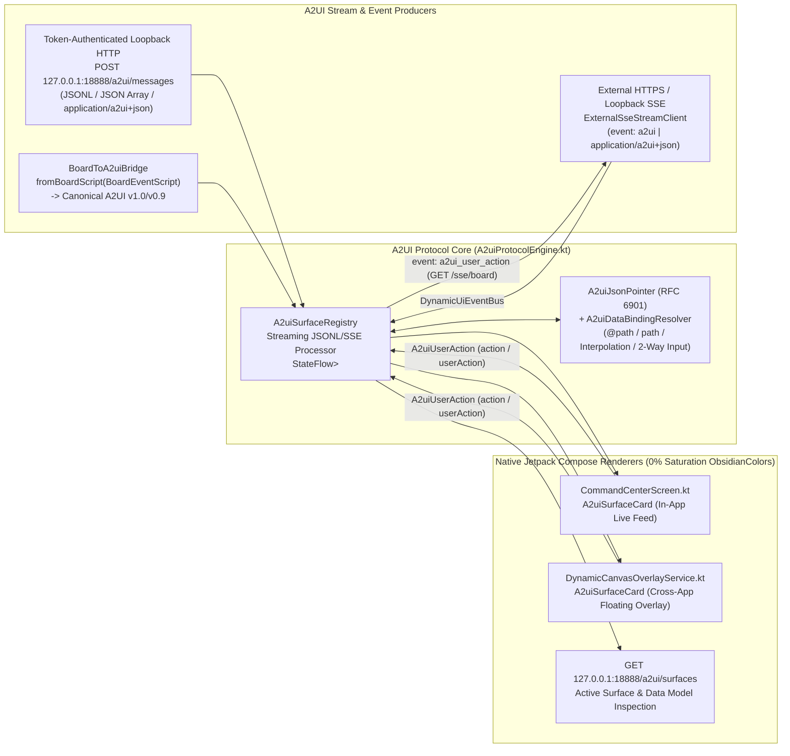

# Google A2UI Protocol Integration (`v1.0` / `v0.9` + `v0.8` Compatibility)

Hanson Mobile-Use AI integrates **Google's official A2UI (Agent-to-User Interface) protocol** (`https://a2ui.org/`, `https://github.com/a2ui-project/a2ui`) natively in Android Jetpack Compose so any A2UI-speaking agent, A2A server, or local CLI bridge can stream declarative, interactive UI surfaces directly onto the user's phone — both **inside the Hanson app** and **floating over arbitrary Android apps** via `SYSTEM_ALERT_WINDOW`.

All rendered surfaces strictly preserve Hanson's **0%-saturation `ObsidianColors` Paper Light (`#FAFAFA` / `#09090B`) & Carbon Dark (`#09090B` / `#FAFAFA`)** achromatic design system.

---

## 1. Supported Wire Standards & Catalogs

| Protocol Layer | Version / Identifier | Wire Envelopes Supported |
| :--- | :--- | :--- |
| **A2UI v1.0** *(Primary)* | `version: "1.0"` | `createSurface` (with optional inline `components` & `dataModel`), `updateComponents`, `updateDataModel`, `deleteSurface`, outbound `action` |
| **A2UI v0.9** *(Primary)* | `version: "v0.9"` | `createSurface`, `updateComponents`, `updateDataModel`, `deleteSurface`, outbound `action` |
| **A2UI v0.8** *(Compat)* | `v0.8` (unversioned envelope) | `surfaceUpdate` (nested `component: { "<Type>": {...} }`), `dataModelUpdate` (`contents` adjacency list), `beginRendering`, `deleteSurface`, outbound `userAction` |
| **Basic Catalog** | `https://a2ui.org/specification/v1_0/catalogs/basic/catalog.json` & `v0_9/catalogs/basic/catalog.json` | `Column`, `Row`, `List`, `Card`, `Box`, `Text`, `Button`, `TextField`, `CheckBox`, `MultipleChoice` / `ChoicePicker`, `Slider`, `Divider`, `Icon`, `Image` |
| **Data Binding** | RFC 6901 JSON Pointer | `{"@path": "/..."}` (v1.0), `{"path": "/..."}` (v0.9/v0.8), `${/ptr}` & `@{/ptr}` string interpolation, v0.8 `literalString` / `literalNumber` / `literalBoolean` / `literalArray`, dynamic template `children` scoping, and `formatString` client function |

---

## 2. End-to-End Architecture



---

## 3. Android Implementation Map

| File | Role |
| :--- | :--- |
| `app/src/main/java/com/hanson/mobileuse/agent/A2uiProtocolEngine.kt` | Streaming JSONL/SSE processor (`v1.0`, `v0.9`, `v0.8`), flat adjacency-list `A2uiComponentNode` registry, RFC 6901 `A2uiJsonPointer`, `A2uiDataBindingResolver`, `A2uiUserAction` outbound dispatch, `A2uiSurfaceRegistry` (`StateFlow<Map<String, A2uiSurfaceState>>`), and `BoardToA2uiBridge.fromBoardScript(script)`. |
| `app/src/main/java/com/hanson/mobileuse/ui/components/A2uiComposeRenderer.kt` | Native Jetpack Compose `A2uiSurfaceCard` and `A2uiSurfaceDeck` mapping every Basic catalog component onto Hanson's 0%-saturation `ObsidianColors` Paper Light & Carbon Dark palette with two-way stateful input bindings and cycle-safe tree recursion (`maxDepth = 24`). |
| `app/src/main/java/com/hanson/mobileuse/agent/SseDynamicUiEngine.kt` | Routes `a2ui` and `application/a2ui+json` frames arriving over `DynamicUiEventBus` or `ExternalSseStreamClient` into `A2uiSurfaceRegistry.ingestJsonLine(...)`, and broadcasts outbound `a2ui_user_action` envelopes over `GET /sse/board`. |
| `app/src/main/java/com/hanson/mobileuse/ui/screens/CommandCenterScreen.kt` | Collects `A2uiSurfaceRegistry.surfaces` and mounts live `A2uiSurfaceCard` items directly inside the main conversation/board feed, handling `open_citation`, `speak_board`, and agent follow-up actions. |
| `app/src/main/java/com/hanson/mobileuse/service/DynamicCanvasOverlayService.kt` | Collects `A2uiSurfaceRegistry.surfaces` inside the out-of-app `SYSTEM_ALERT_WINDOW` Compose overlay so A2UI surfaces float cleanly over other Android apps alongside Co-Drawing and SSE cards. |
| `app/src/main/java/com/hanson/mobileuse/accessibility/ArtemisCommandServer.kt` | Exposes token-authenticated `POST /a2ui/messages` and `GET /a2ui/surfaces` routes on `127.0.0.1:18888` and advertises A2UI capability in `/.well-known/agent-card.json` without modifying `ToolSpecRegistry`. |
| `app/src/test/java/com/hanson/mobileuse/agent/A2uiProtocolEngineTest.kt` | JUnit 4 unit test suite covering v1.0, v0.9, v0.8 JSONL parsing, RFC 6901 JSON Pointer resolution & two-way state mutation, `A2uiUserAction` dispatch, `deleteSurface`, `BoardToA2uiBridge`, `DynamicUiEventBus` routing, and monochrome/security invariants. |

---

## 4. Basic Catalog → Hanson Achromatic Compose Mapping

| A2UI Component | Jetpack Compose Mapping | Paper Light / Carbon Dark Styling & Interactivity |
| :--- | :--- | :--- |
| `Column`, `Row`, `List`, `Box` | `Column`, `Row`, scrollable `Row`/`Column`, `Box` | Honors `justify`, `align`, `direction`, child `weight`, static `children` lists, and data-bound template `children: { componentId, path }`. |
| `Card` | Rounded `14.dp` container | `ObsidianColors.SurfaceHigh` fill + `1.dp` `ObsidianColors.GlassBorder` hairline. |
| `Text` | `Text` (`h1`..`h5`, `body`, `caption`) | Resolves `@path`, `path`, `${/ptr}`, `@{/ptr}`, and `formatString`; auto-inverts to `ObsidianColors.OnAccent` inside `primary` buttons. |
| `Button` | Tactile pill container (`primary` / `default` / `borderless`) | `primary` uses `ObsidianColors.Accent` / `OnAccent`; resolves `action.event.context` dynamically from `dataModel` and emits `A2uiUserAction`. |
| `TextField` | `OutlinedTextField` (`shortText`, `longText`, `number`, `obscured`) | Monochrome `ObsidianColors` borders/cursor; writes edits directly back to bound RFC 6901 JSON Pointer in `A2uiSurfaceRegistry`. |
| `CheckBox` | Monochrome bordered toggle row | Two-way boolean mutation at bound JSON Pointer (`ObsidianColors.Accent` fill + `Icons.Default.Check`). |
| `MultipleChoice` / `ChoicePicker` | `FlowRow` chips or stacked option rows | Supports `mutuallyExclusive` and `multipleSelection` modes (`displayStyle: chips | checkbox`); mutates bound string list in `dataModel`. |
| `Slider` | Material 3 `Slider` + monospace readout | Safely clamps `min..max` and discrete `steps`; mutates bound numeric JSON Pointer in `dataModel`. |
| `Divider` | `HorizontalDivider` / vertical hairline `Box` | `1.dp` `ObsidianColors.Divider`. |
| `Icon` | Material Vector `Icon` | Maps standard A2UI Basic catalog icon names onto `Icons.Default.*` / `Icons.AutoMirrored.Filled.*` tinted strictly in `ObsidianColors`. |
| `Image` | Monochrome media frame (`icon`, `avatar`, `smallFeature`..`header`) | Displays alt `description` and sanitized host badge; strictly allows only `https://` or loopback hosts (`file://` & `javascript:` blocked). |

---

## 5. Wire Protocol Examples

### Streaming A2UI v1.0 JSONL via `POST 127.0.0.1:18888/a2ui/messages`

```bash
curl -X POST http://127.0.0.1:18888/a2ui/messages \
  -H "X-Artemis-Token: <SESSION_TOKEN>" \
  -H "Content-Type: application/a2ui+jsonl" \
  --data-binary $'{"version":"1.0","createSurface":{"surfaceId":"trip_card","catalogId":"https://a2ui.org/specification/v1_0/catalogs/basic/catalog.json"}}\n{"version":"1.0","updateComponents":{"surfaceId":"trip_card","components":[{"id":"root","component":"Column","children":["t1","btn1"]},{"id":"t1","component":"Text","text":"목적지: @{/trip/city}","variant":"h2"},{"id":"btn_lbl","component":"Text","text":"경로 시작"},{"id":"btn1","component":"Button","variant":"primary","child":"btn_lbl","action":{"event":{"name":"start_route","context":{"city":{"@path":"/trip/city"}}}}}]}}\n{"version":"1.0","updateDataModel":{"surfaceId":"trip_card","path":"/trip","value":{"city":"성수동"}}}'
```

### Inspecting Active Surfaces via `GET 127.0.0.1:18888/a2ui/surfaces`

```bash
curl -H "X-Artemis-Token: <SESSION_TOKEN>" \
  "http://127.0.0.1:18888/a2ui/surfaces?components=true"
```

### Outbound `A2uiUserAction` Envelope (`v1.0` / `v0.9`)

```json
{
  "version": "1.0",
  "action": {
    "name": "start_route",
    "surfaceId": "trip_card",
    "sourceComponentId": "btn1",
    "timestamp": "2026-11-24T02:20:00Z",
    "context": {
      "city": "성수동"
    }
  }
}
```

---

## 6. Security & Design Invariants

- **Strict Loopback Token Auth**: Both `POST /a2ui/messages` and `GET /a2ui/surfaces` execute behind `ArtemisCommandServer`'s constant-time `X-Artemis-Token` / `Authorization: Bearer` gate (64KB payload limit, zero wildcard CORS).
- **Safe URL & Scheme Enforcement**: Action handlers (`open_citation`, `open_url`) allow only `https://` URLs; `Image` component host badges reject `file://`, `content://`, and `javascript:` schemes.
- **0%-Saturation Achromatic Compliance**: `A2uiComposeRenderer.kt` uses exclusively `ObsidianColors` tokens so `PureAchromaticDesignTest` remains 100% green across Paper Light and Carbon Dark modes.
- **Cycle & Depth Protection**: Recursive component rendering tracks `(componentId, scopePath)` visited sets and caps nesting at `24` levels so malformed or cyclic adjacency graphs never stack-overflow Compose.
