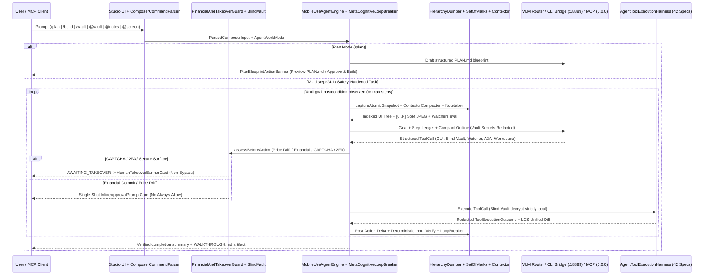

# Hanson Mobile-Use — Mobile Agent Studio v6.1 Architecture

Hanson Mobile-Use (Studio v6.1) is an empirical, closed-loop Android **Human-First Companion & Mobile Agent Studio**. It pairs a Figma-designed **Natural Language → Interactive UI + Motion Moat (`InteractiveMorphEngine` + `HumanFirstCompanionCards`)** and **Human-First Convenience layer (`HumanFirstConvenienceEngine`: Memory Bubbles, Proactive Daily Brief, ACL 2026 D-Artemis `TAC+ACA` alignment, 1-Tap Undo, Show-Me-Once Routines, Call Concierge, optional BYO Cloud Firestore Sync)** with **Set-of-Marks (`[index]`) visual grounding**, **multi-window Accessibility extraction**, **Blind Credential Vault (`vault://` AES-256-GCM)**, **non-bypassable Human Takeover & Financial/Price-Drift circuit breakers**, **end-to-end pre-release security hardening (`SECURITY.md`)**, a **sandboxed workspace + LCS unified diff workbench**, and a **two-track reasoning bridge** (`6.0.0` MCP / `:18889` CLI Bridge).

See [`MOBILE_AGENT_REVERSE_ENGINEERING_2026.md`](MOBILE_AGENT_REVERSE_ENGINEERING_2026.md) for the SOTA capability mapping table and [`../SECURITY.md`](../SECURITY.md) for the full threat model.

---

## 1. End-to-End Execution Loop

Every user prompt enters through the Studio composer (`Auto | Plan | Build` modes, 13 `/` slash commands including `/vault`, `/watch`, `/a2a`, `/notes`, and `@screen`, `@app`, `@vault`, `@notes`, `@watchers`, `@file:...` mentions):

---

## 2. Core Subsystems

### 2.1 Multi-Window Perception & Set-of-Marks (`app/src/main/java/com/hanson/mobileuse/accessibility/`)
- **[`HansonAccessibilityService.kt`](../app/src/main/java/com/hanson/mobileuse/accessibility/HansonAccessibilityService.kt)**: Connects to `BIND_ACCESSIBILITY_SERVICE` with `FLAG_RETRIEVE_INTERACTIVE_WINDOWS` and API 33+ hybrid prefetching. Dispatches `GestureDescription` taps, long-presses, 40%-overlap anchored swipes, and gesture bursts while flipping the floating HUD to `FLAG_NOT_TOUCHABLE` so overlays never intercept touches.
- **[`HierarchyDumper.kt`](../app/src/main/java/com/hanson/mobileuse/accessibility/HierarchyDumper.kt)**: Traverses `getWindows()` in Z-order, filters invisible/zero-area noise, clips bounds to scroll containers, and emits an `AtomicScreenSnapshot` containing:
  - `elements: List<IndexedUiElement>` with `[0..N]` indices, `centerX`/`centerY` pixels, `normX`/`normY` (`0..1000` normalized coordinates), `text`, `contentDesc`, `resourceId`, and `{clickable, editable, scrollable, checkable, checked, focused}` flags.
  - Raw `screenshotBase64` and `somScreenshotBase64`.
- **[`SetOfMarksAnnotator.kt`](../app/src/main/java/com/hanson/mobileuse/accessibility/SetOfMarksAnnotator.kt)**: Draws color-coded bounding boxes and collision-avoided `[index]` badges onto a downscaled copy of the screenshot (`maxDimension = 1280px`) so VLMs can ground visual icons (magnifying glasses, close buttons, image cards) directly to `element_index`.

### 2.2 Intent Routing, 42 Tool Specs, Pickle SOTA & Closed-Loop Verification (`app/src/main/java/com/hanson/mobileuse/agent/`)
- **[`ToolSpecRegistry.kt`](../app/src/main/java/com/hanson/mobileuse/agent/ToolSpecRegistry.kt)**: Single source of truth for **42 on-device agent tool specs** — 31 GUI/Notification/OS/UARP/Omni-Nexus tools, 6 Studio v4.0 workspace tools (`workspace_list`, `workspace_read`, `workspace_write`, `workspace_edit`, `workspace_search`, `workspace_exec`), plus 5 Studio v5.0 Pickle & SOTA tools (`vault_blind_inject`, `vault_list_handles`, `watcher_manage`, `a2a_negotiate_schedule`, `scratchpad_note`).
- **[`PickleSotaAbsorptionEngine.kt`](../app/src/main/java/com/hanson/mobileuse/agent/PickleSotaAbsorptionEngine.kt)**: Consolidates `BlindCredentialVault` (AES-256-GCM handle-based secret injection), `FinancialAndTakeoverGuard` (non-bypassable `AWAITING_TAKEOVER` on CAPTCHA/Turnstile/2FA/secure keypads + mandatory 1-shot approval on financial/price-drift actions even in autonomous mode), `ProactiveWatcherEngine`, `PickleA2AScheduleNegotiator`, `NotetakerScratchpad`, `MetaCognitiveLoopBreaker`, and `ContextorCompactor`.
- **[`AgentToolExecutionHarness.kt`](../app/src/main/java/com/hanson/mobileuse/agent/AgentToolExecutionHarness.kt)**: Executes the 5 Pickle & SOTA handlers and applies `redactSensitiveText` so raw secrets from `BlindCredentialVault` never leak into logs or model prompts.
- **[`IntentDecomposerAndRouter.kt`](../app/src/main/java/com/hanson/mobileuse/agent/IntentDecomposerAndRouter.kt)**: Splits single-shot OS hardware actions (`EVERYDAY_OS_ACTION`), scroll/navigation reflexes (`REFLEX_MICRO_CONTROL`), Korean Jamo-phonetic on-screen element taps (`SCREEN_ELEMENT_TARGET`), compound routines (`COMPOUND_LIFESTYLE_ROUTINE`), and on-demand HTML5/SVG synthesis (`GENERATIVE_CODE_OR_MEDIA`) from genuine multi-step GUI tasks (`MULTI_STEP_GUI_OR_CHAT`). Includes strict self-click protection (`isHansonOwnElement`) so the agent never taps its own chat bubbles.
- **[`AppReverseEngineeringEngine.kt`](../app/src/main/java/com/hanson/mobileuse/agent/AppReverseEngineeringEngine.kt) & [`ActionTrajectoryVerifierAndHealer.kt`](../app/src/main/java/com/hanson/mobileuse/agent/ActionTrajectoryVerifierAndHealer.kt)**: Adds `detectSurfaceCapabilities` for target surface profiling, `verifyInputTextDeterministic`, `"vault_blind_inject"` handling in `verifyAndSelfHeal` (with `"handle"` resolved in `evaluateTransitionOnly`), and explicitly blocks `execOsCliFallback("text ...")` during `"vault_blind_inject"` recovery.
- **[`MobileUseAgentEngine.kt`](../app/src/main/java/com/hanson/mobileuse/agent/MobileUseAgentEngine.kt)**: Runs the deliberative `Observe → Decide → Act → Verify` loop:
  - Computes post-action screen deltas (package transitions, window title changes, element count/digest changes, focused `EditText` readiness).
  - Detects stagnant loops (repeated identical actions with zero screen delta) and injects recovery hints into the next VLM turn.
  - Enforces **goal postcondition guards**: if a user asks to search or enter text inside an app and the model attempts `complete_task` immediately after launching the app, the engine rejects premature completion and continues until text entry and result transition are observed.
- **[`NeuralSkillCompilerAndDistiller.kt`](../app/src/main/java/com/hanson/mobileuse/paradigm/NeuralSkillCompilerAndDistiller.kt)**: Records verified action trajectories (`VerifiedActionShortcut`) keyed by package and UI structural fingerprint so recurring sub-steps can replay with explicit step verification.

### 2.3 Two-Track Brain Router & Desktop Bridges
1. **Track 1 — On-Phone Universal VLM (`GeminiMultimodalClient.kt` + `MobileAiInfrastructureRouter.kt`)**:
   - Supports **Google Gemini**, **Anthropic Claude**, **OpenAI**, **OpenRouter**, and any **Custom OpenAI-Compatible endpoint** (`customBaseUrl` + `customModelId`, e.g., Ollama, vLLM, LM Studio, Groq, Together).
   - Includes a `DeadKeyCircuitBreaker` for `401`/`402`/`403` errors and a live **1-Tap Connection Test (`testConnection`)** surfaced in `SettingsScreen` and `EditorialApiKeySheet`.
2. **Track 2 — Zero-API-Cost External Agent & Desktop Workspace Bridges**:
   - **MCP Server ([`mcp/mobile_use_mcp_server.py`](../mcp/mobile_use_mcp_server.py), `SERVER_VERSION = "6.0.0"`)**: Speaks MCP (`2025-03-26` / `2024-11-05`) over `stdio` (newline-delimited JSON-RPC and `Content-Length` framing). Preserves all **12 core MCP tools** (`mobile_get_screen`, `mobile_click`, `mobile_long_press`, `mobile_input_text`, `mobile_swipe`, `mobile_press_key`, `mobile_launch_app`, `mobile_list_apps`, `mobile_open_url`, `mobile_get_notifications`, `mobile_reply_notification`, `mobile_device_setting`) with `0`-based `element_index` schemas, shell-quoted (`shlex.quote`) & allowlisted ADB fallbacks, and Studio v6.0/v6.1 instructions inside `initialize.instructions`.
   - **Laptop CLI & Workspace Bridge ([`laptop-cli-bridge.py`](../laptop-cli-bridge.py), `:18889`, `6.0.0`)**: Tunneled to the phone via `adb reverse tcp:18889 tcp:18889`, enforcing browser CSRF (`Origin`/`Referer`/`Sec-Fetch-*`) and DNS-rebinding (`Host`) `HTTP 403` blocks, `Content-Type: application/json` enforcement on `POST` (`HTTP 415`), and optional constant-time `X-Bridge-Token` auth (`--token` / `HANSON_BRIDGE_TOKEN`).
     - **Reasoning & Capabilities Routes**: `/decide` (invokes `claude -p`, `codex exec -i <som.jpg>`, `gemini -p`, OpenAI-compatible API, or sub-10ms heuristic), `/bridge`, `/pickle/capabilities` (`validToolsCount == 28` matching `VALID_TOOLS`), and `/health` (`version: "6.0.0"`, `valid_tools_count == 28`, `workspace_routes: true`, and safe non-PII `workspace_root` basename).
     - **Sandboxed Workspace Routes (`--workspace-root`, default `./agent_workspace`)**:
       - `GET` / `POST /workspace/list` — lists relative file paths, sizes, and line counts (ignoring `.git`, `__pycache__`, `.checkpoints`).
       - `POST /workspace/read` — reads `{path, start_line, end_line}` and returns `lines` + `total_lines`.
       - `POST /workspace/write` — writes `{path, content}` inside sandbox and returns `unified_diff`, `added_lines`, `removed_lines`.
       - `POST /workspace/edit` — performs exact unique `{path, old_text, new_text}` replacement and returns `unified_diff`, `added_lines`, `removed_lines`.
       - `POST /workspace/search` — searches `{query, path_prefix}` and returns `path:line: content` matches.
       - `POST /workspace/exec` — executes commands with `cwd=WORKSPACE_ROOT` and timeout, returning `{ok, exit_code, stdout, stderr}`. Secure-by-default (`--allow-workspace-exec` defaults to `False`): permits only read-only diagnostic commands (`ls`, `dir`, `pwd`, `cat`, `type`, `head`, `tail`, `wc`, `findstr`, `grep`, `python --version`, `pytest --version`, `git status`, `git diff`) and rejects shell chaining (`&&`, `||`, `;`, `|`, `>`, `<`, `$`, `` ` ``) and path escapes (`..`, absolute paths, drive prefixes, sibling prefix escapes) with `HTTP 403`.

### 2.4 Dual-Lane (`FG` / `BG`) Execution & Loopback Servers
- **Foreground Lane (`FG`)**: Owns physical screen gestures, app launches, and UI transitions (serialized via mutex so concurrent threads never contend over the touch screen).
- **Background Lane (`BG`)**: Runs screenless operations concurrently — `RemoteInput` notification replies (`HansonNotificationListenerService`), `QUERY_ALL_PACKAGES` discovery, OS settings/calendar/notes, workspace operations, and headless `browser_use` DOM extraction.
- **Loopback Bridges**:
  - `:18888` ([`ArtemisCommandServer.kt`](../app/src/main/java/com/hanson/mobileuse/accessibility/ArtemisCommandServer.kt), `"6.0.0"` / `droidrun-portal-v6`): `/snapshot`, `/elements`, `/dump_xml`, `/action`, `/rpc`, `/mcp/tools`, `/portal/ping`, `/portal/state`, `/portal/brief`, `/portal/undo`, `/a2a` (`pickle/negotiate_schedule`), and `/chat`.
  - `:18890` ([`HansonOsCliMain.kt`](../app/src/main/java/com/hanson/mobileuse/oscli/HansonOsCliMain.kt)): Optional `UID 2000 (shell)` Binder helper with 256-bit token + `/proc/net/tcp` caller UID verification and `ALLOWED_ACTIONS` allowlist.

### 2.5 v6.0 Human-First Companion, BYO Firestore Sync & v6.1 Flagship Motion Morph UI
- **[`InteractiveMorphEngine.kt`](../app/src/main/java/com/hanson/mobileuse/agent/InteractiveMorphEngine.kt)**: Synthesizes natural language + active `HumanMemoryBubble` preferences into direct-manipulation interactive cards (`SPLIT_BILL`, `FOOD_CURATOR`, `TIMELINE_PLANNER`, `MEDIA_STORYBOARD`, `CALL_CONCIERGE`) with Korean currency/headcount parsing, 100-won rounding, and XSS-escaped achromatic micro-app HTML export to `GenerativeUiRenderer`.
- **[`HumanFirstConvenienceEngine.kt`](../app/src/main/java/com/hanson/mobileuse/agent/HumanFirstConvenienceEngine.kt)**: Implements `UserExperienceMode` (`SIMPLE_HUMAN` | `STUDIO_PRO`), `HumanMemoryBubblesStore`, `ProactiveDailyBriefEngine`, `SmartClipboardAndShareIntentDetector`, `ArtemisDeliberativeAligner` (ACL 2026 D-Artemis `TAC+ACA`), `HumanStepTranslator`, `ReversibleReceiptPlanner` (1-Tap Undo), `PersonalRoutineStore` ("Show-Me-Once"), and `CallConciergePlanner`.
- **[`HansonFirestoreCloudSyncEngine.kt`](../app/src/main/java/com/hanson/mobileuse/agent/HansonFirestoreCloudSyncEngine.kt) & [`firestore.rules`](../firestore.rules)**: Optional Bring-Your-Own Firebase sync via runtime `FirebaseOptions` (zero bundled config JSON); encrypts the BYO API key inside `BlindCredentialVault`, merges sanitized `bubbles`/`routines`/`watchers`/`receipts` with LWW resolution, enforces strict owner-scoped `request.auth.uid == userId` + doc-ID binding + integer timestamps + immutable undo metadata, and unconditionally denies `/users/{userId}/vault/**`.
- **[`HumanFirstCompanionCards.kt`](../app/src/main/java/com/hanson/mobileuse/ui/components/HumanFirstCompanionCards.kt) & [`docs/studio-preview.html`](studio-preview.html)**: Implements the Figma-redesigned (`b5ATkku4hfGkjIu9K6Ozuv`, page `"02 · Flagship Generative Motion UI"`) ambient hero (`LivingPresenceHeroStage`), `ContextualFocusDeckCard`, `InteractiveMorphSurfaceCard`, `DynamicExecutionIslandBanner`, `FloatingOneTapUndoPill`, `FlagshipQuickPillDock`, and on-demand `CompanionDrawerBottomSheet`.

### 2.6 Mobile Agent Studio: Workspace, Multi-Session, Pickle Hub & Ahaboard UI (`workspace/` & `ui/`)
- **[`MobileWorkspaceEngine.kt`](../app/src/main/java/com/hanson/mobileuse/workspace/MobileWorkspaceEngine.kt)**:
  - Dual constructors (`Context` → `filesDir/agent_workspace`, and `File` for pure JVM unit testing).
  - Canonical sandbox enforcement (`resolveSafePath`) blocking blank paths, absolute paths, `..` traversal, and sibling prefix collisions with `SecurityException`.
  - `UnifiedDiffComputer`: pure-Kotlin LCS (Longest Common Subsequence) line diff engine emitting standard `@@ ... @@` hunks with exact `addedLines` / `removedLines` counts.
  - Supports `initAgentsMd()` (`/init AGENTS.md`), `.checkpoints/` snapshot & restore (`captureCheckpoint` / `restoreCheckpoint`), `PLAN.md` / `WALKTHROUGH.md` artifact updates, and allowlisted sandbox diagnostics (`execWorkspaceCommand`).
- **[`AgentSessionStore.kt`](../app/src/main/java/com/hanson/mobileuse/workspace/AgentSessionStore.kt)**:
  - Manages parallel `SessionThread` entries (`id`, `title`, `mode: AgentWorkMode`, `isForeground`, `statusBadge`, `foregroundPackage`, `unreadCount`, `planMarkdown`, `walkthroughMarkdown`, `hasPendingApproval`) persisted to JSON.
  - `ComposerCommandParser`: parses **13 `/` slash commands** (`/auto`, `/plan`, `/build`, `/init`, `/files`, `/diff`, `/undo`, `/sessions`, `/help`, `/vault`, `/watch`, `/a2a`, `/notes`) and `@` context mentions (`@screen`, `@app`, `@tree`, `@diff`, `@agents`, `@file:<path>`, `@vault`, `@notes`, `@watchers`).
- **[`PickleAgentHubSheet.kt`](../app/src/main/java/com/hanson/mobileuse/ui/components/PickleAgentHubSheet.kt), [`MobileAgentStudioComponents.kt`](../app/src/main/java/com/hanson/mobileuse/ui/components/MobileAgentStudioComponents.kt) & [`MobileCodeWorkbenchSheet.kt`](../app/src/main/java/com/hanson/mobileuse/ui/screens/MobileCodeWorkbenchSheet.kt)**:
  - Studio top bar (`StudioTopHeaderBar`) with `Auto | Plan | Build` segmented pill switcher, `"Work with Apps"` companion strip (`WorkWithAppsCompanionStrip`) with `@screen` chip insertion, `🛡️ Vault` pill, and HUD toggle, floating `/` & `@` palette (`SlashAndMentionPaletteCard`), inline 3-tier approval prompt (`InlineApprovalPromptCard` — `거부` / `이번만 허용` / `항상 허용`, with single-shot enforcement on financial/price-drift actions), non-bypassable `HumanTakeoverBannerCard` (`AWAITING_TAKEOVER`), collapsible live checklist (`LiveExecutionChecklistCard`), Plan blueprint banner (`PlanBlueprintActionBanner`), `FG`/`BG` Session Inbox Drawer (`SessionInboxDrawerSheet`), 4-tab `MobileCodeWorkbenchSheet` (`Files`, `Diff`, `Artifacts`, `Undo`), and 4-tab `PickleAgentHubSheet` (`Agent Safety & Memory Hub` featuring `AES-256-GCM Blind Vault`, Watchers, A2A Negotiation, and Scratchpad Notes).
- **Ahaboard 0%-Saturation Palette ([`Color.kt`](../app/src/main/java/com/hanson/mobileuse/ui/theme/Color.kt)) & Interactive Preview ([`studio-preview.html`](studio-preview.html))**:
  - `ObsidianColors` switches strictly between `HansonUiStyle.AHABOARD_PAPER` (`#FAFAFA` / `#FFFFFF` / `#09090B` ink) and `HansonUiStyle.AHABOARD_CARBON` (`#09090B` / `#121214` / `#FAFAFA` ink) with 0% hue saturation across all semantic and status tokens.
  - [`docs/studio-preview.html`](studio-preview.html) renders a self-contained `390×844` interactive prototype mirroring Studio v5.0 flows (`Vault·2 (1)`, 4-tab Hub modal + A2A negotiation, Price-Drift & Non-Bypass Human Takeover cards, `/vault|/watch|/a2a|/notes`, `@vault/@notes/@watchers`) in both Paper Light and Carbon Dark themes.

---

## 3. Coordinate & Grounding Conventions

| Coordinate Type | Range | Usage |
|---|---|---|
| `element_index` | `0 .. N` | **Preferred.** Resolves to the exact `centerX, centerY` of the indexed `AccessibilityNodeInfo` from the latest snapshot. |
| `norm_x`, `norm_y` | `0 .. 1000` | Resolution-independent fallback (`px = norm * screenDimension / 1000`). |
| `x`, `y` (MCP / ADB) | Device pixels | Supported directly by `mobile_click` in `mcp/mobile_use_mcp_server.py` when operating in raw pixel mode. |
| `relativePath` (Workspace) | Sandbox-relative | Canonical POSIX path resolved strictly under `WORKSPACE_ROOT` (`MobileWorkspaceEngine` & `:18889` bridge). |
