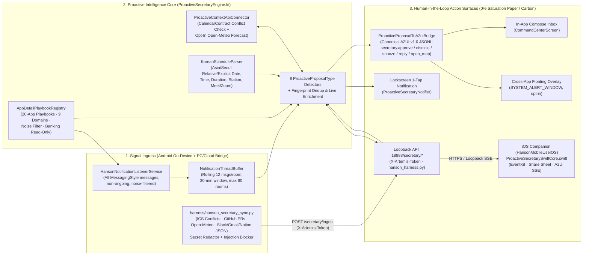

# Proactive Chief-of-Staff AI Secretary Architecture / 능동형 비서실장 AI 비서 아키텍처 (`v6.7.0`)

Hanson Mobile-Use AI `v6.7.0` introduces the **Proactive Chief-of-Staff AI Secretary (능동형 비서실장 AI 비서)**: an on-device + PC/Cloud-synced ambient chief-of-staff that watches multi-turn messaging threads, calendar conflicts, reservations, deliveries, work deadlines, and optional commute weather — then surfaces **1-tap, human-approved proposals** across In-App Compose, Cross-App A2UI Overlay, Lockscreen Quick-Action Notifications, `:18888` Loopback CLI/Python Harness, and the iOS SwiftUI Companion.

> **Core Philosophy / 핵심 원칙**: **Proactive suggestion, explicit human approval (선제 제안 · 원탭 승인).** Hanson prepares calendar inserts, conflict warnings, departure deep links, and quick-reply drafts automatically, but **never executes unsolicited replies, calendar writes, or financial actions** without user confirmation.

---

## 1. End-to-End Architecture Flow / 종단간 아키텍처 흐름

---

## 2. 20-App Detail Intelligence Matrix / 20대 핵심 앱 상세 인텔리전스 매트릭스 (`AppDetailPlaybookRegistry`)

Every supported Korean and global app is registered in `AppDetailPlaybookRegistry` across **9 `AppDomainCategory` domains** (`MESSENGER`, `WORK_CHAT`, `EMAIL`, `RESERVATION`, `DELIVERY`, `FINANCE_ADVISORY`, `MOBILITY`, `PRODUCTIVITY`, `GENERAL`). Each playbook defines multi-turn thread expectations, ad/noise filtering rules, deep-link helpers, GUI guidance, and whether `readOnlyAdvisoryOnly` is hard-locked.

| # | App / Service | Package Name(s) | Domain Category | Primary Proactive Proposals | Special Guardrails & Handling |
| :-: | :--- | :--- | :--- | :--- | :--- |
| 1 | **카카오톡 (KakaoTalk)** | `com.kakao.talk` | `MESSENGER` | `CALENDAR_EVENT`, `UNANSWERED_FOLLOWUP`, `MEETING_LINK_PREP` | Extracts **all** `MessagingStyle.messages` into `NotificationThreadBuffer` for multi-turn merging; suppresses channel ads & sticker/photo-only noise |
| 2 | **Slack** | `com.Slack` | `WORK_CHAT` | `DEADLINE_TASK`, `MEETING_LINK_PREP`, `UNANSWERED_FOLLOWUP` | Detects `"오늘까지"`, `"리뷰 부탁"`, `"회신 부탁"`, and huddle/Zoom/Meet links per channel/thread |
| 3 | **Microsoft Teams** | `com.microsoft.teams` | `WORK_CHAT` | `MEETING_LINK_PREP`, `DEADLINE_TASK`, `CALENDAR_EVENT` | Extracts `teams.microsoft.com/l/meetup-join/...` links for 5-min alarm + DND prep |
| 4 | **Discord** | `com.discord` | `WORK_CHAT` | `CALENDAR_EVENT`, `DEADLINE_TASK`, `UNANSWERED_FOLLOWUP` | Filters noisy server-wide broadcasts unless direct mention/DM |
| 5 | **Telegram** | `org.telegram.messenger` | `MESSENGER` | `CALENDAR_EVENT`, `UNANSWERED_FOLLOWUP`, `MEETING_LINK_PREP` | Multi-turn room buffer + quick-reply draft proposals when `canQuickReply == true` |
| 6 | **LINE** | `jp.naver.line.android` | `MESSENGER` | `CALENDAR_EVENT`, `UNANSWERED_FOLLOWUP` | Filters Official Account `(광고)` promotions; preserves human group chat context |
| 7 | **WhatsApp** | `com.whatsapp` | `MESSENGER` | `CALENDAR_EVENT`, `UNANSWERED_FOLLOWUP`, `MEETING_LINK_PREP` | Bilingual Korean/English schedule & follow-up extraction |
| 8 | **Samsung / Google SMS** | `com.samsung.android.messaging`, `com.google.android.apps.messaging` | `MESSENGER` | `RESERVATION_COMMUTE`, `DELIVERY_TRACKING`, `BILLING_SUBSCRIPTION_WATCH` | Strictly strips `[Web발신]` promos and **rejects all OTP / 2FA verification codes** |
| 9 | **Gmail** | `com.google.android.gm` | `EMAIL` | `DEADLINE_TASK`, `MEETING_LINK_PREP`, `RESERVATION_COMMUTE` | Parses approval/quote/minutes deadlines (`승인 요청`, `견적서`, `회의록`) & flight/hotel confirmations |
| 10 | **Outlook** | `com.microsoft.office.outlook` | `EMAIL` | `DEADLINE_TASK`, `MEETING_LINK_PREP`, `CALENDAR_EVENT` | Parses meeting invites & Teams URLs; checks `CalendarContract` conflicts |
| 11 | **네이버 메일 (Naver Mail)** | `com.nhn.android.mail` | `EMAIL` | `DEADLINE_TASK`, `RESERVATION_COMMUTE`, `BILLING_SUBSCRIPTION_WATCH` | Filters Korean newsletter/ad headers while keeping billing & reservation notices |
| 12 | **Notion** | `notion.id` | `PRODUCTIVITY` | `DEADLINE_TASK` | Converts page mentions, review assignments, and comment tasks into deadline checklists |
| 13 | **GitHub / Jira / Linear** | `com.github.android`, `com.atlassian.android.jira.core`, `com.linear` | `PRODUCTIVITY` | `DEADLINE_TASK` | Normalizes PR review requests, assigned tickets, and CI failure alerts (also synced via `hanson_secretary_sync.py --github`) |
| 14 | **캐치테이블 (CatchTable)** | `kr.co.catchtable.global` / `catchtable` | `RESERVATION` | `RESERVATION_COMMUTE` | Extracts restaurant booking time + venue -> Calendar + Naver Map deep link + departure alarm |
| 15 | **코레일톡 / SRT** | `com.korail.talk`, `com.srail.srt` | `RESERVATION` | `RESERVATION_COMMUTE` | Extracts departure station/time -> station departure alert + transit route link |
| 16 | **네이버 지도 (Naver Map)** | `com.nhn.android.nmap` | `MOBILITY` | `RESERVATION_COMMUTE` | Target for `buildDeepLinkForPlace(place)` & `open_map` 1-tap navigation action |
| 17 | **카카오 T (Kakao T)** | `com.kakao.taxi` | `MOBILITY` | `RESERVATION_COMMUTE` | Commute/departure companion handoff (never books rides without explicit user tap) |
| 18 | **쿠팡 (Coupang)** | `com.coupang.mobile` | `DELIVERY` | `DELIVERY_TRACKING` | Arrival/pickup reminder note; **door/locker PINs always redacted** |
| 19 | **배달의민족 / 쿠팡이츠 / 택배 3사** | `com.sampleapp`, `com.coupang.mobile.eats`, CJ/Hanjin/Lotte parcel apps | `DELIVERY` | `DELIVERY_TRACKING` | Live pickup/delivery ETA note; strictly strips 공동현관/보관함 PINs |
| 20 | **금융 · 결제 읽기 전용 안내 (Finance Advisory)** | `viva.republica.toss`, `com.kakaobank.channel`, `com.shinhan`, `com.kbcard`, `com.samsung.android.spay` | `FINANCE_ADVISORY` | `BILLING_SUBSCRIPTION_WATCH` | **`readOnlyAdvisoryOnly = true` HARDLINE**: NEVER clicks, types, or automates financial UIs; proposes calendar reminders or notes only |

---

## 3. Eight `ProactiveProposalType` Detectors & Multi-Turn Enrichment / 8종 제안 탐지기 및 멀티턴 병합

| `ProactiveProposalType` | Trigger Signals & Context | Enriched Output & 1-Tap Actions |
| :--- | :--- | :--- |
| `CALENDAR_EVENT` | Multi-turn room messages parsed by `KoreanScheduleParser` (`"금요일에 강남에서 볼래?"` -> `"오후 7시 11번 출구 스타벅스로 확정!"`) | Exact `Asia/Seoul` `startTimeMs`/`endTimeMs`, venue, `CalendarContract` conflict check -> `approve` (Calendar Insert + Reminder), `snooze`, `dismiss` |
| `DEADLINE_TASK` | `"오늘까지"`, `"내일 오전까지"`, `"마감"`, `"회신 부탁"`, `"리뷰 부탁"`, `"승인 요청"`, `"견적서"`, `"회의록"`, GitHub PR reviews | Structured due-time task card -> `approve` (Reminder/Checklist), `snooze`, `dismiss` |
| `UNANSWERED_FOLLOWUP` | Human question with `canQuickReply == true` left unanswered past `unansweredFollowupMinutes` (default `10m`) or urgent inquiry | Generates 2–3 polite Korean quick-reply drafts -> `reply` via `RemoteInputSessionCache` only on explicit tap |
| `MEETING_LINK_PREP` | `meet.google.com`, `zoom.us`, `teams.microsoft.com`, `whereby.com`, `webex.com` URLs | Calendar entry + 5-min pre-meeting alarm + DND prep suggestion |
| `RESERVATION_COMMUTE` | CatchTable, Korail, SRT, hotel/flight confirmations, or ICS physical-location events | Calendar entry + `open_map` Naver Map deep link + departure buffer |
| `DELIVERY_TRACKING` | Coupang, Baemin, Coupang Eats, CJ/Hanjin/Lotte, SMS delivery notices | Pickup reminder / delivery log with **automatic door/locker PIN redaction** |
| `BILLING_SUBSCRIPTION_WATCH` | Bill due dates, recurring subscription renewals, high-amount alerts | **Read-only advisory card** (`isReadOnlyAdvisory`) — note/reminder only, zero financial UI automation |
| `UPCOMING_PREP_BRIEF` | `CalendarContract` overlaps, tight back-to-back physical transitions, opt-in Open-Meteo rain/cold alerts, related unread threads | Unified chief-of-staff briefing card with monochrome `CONFLICT` badge |

### Multi-Turn Deduplication & Live Enrichment
- Each proposal carries a deterministic `fingerprint` derived from `(packageName, roomKey, type, normalizedWindow)`.
- When follow-up messages arrive in the same room within the 30-minute rolling `NotificationThreadBuffer` window (max 12 messages/room, 60 rooms), `ProactiveSecretaryEngine` **updates the existing `PENDING` proposal in place** (filling in exact time, venue, and refreshed `hasCalendarConflict`) instead of spamming duplicate alerts.
- State is persisted atomically in `hanson_proactive_proposals.json` and `hanson_secretary_prefs.json` (`enabled`, `mutedPackages`, `quietHoursStart = 23`, `quietHoursEnd = 7`, `weatherPrepEnabled = false` opt-in, `floatingA2uiOverlayEnabled = false` opt-in, `unansweredFollowupMinutes = 10`).

---

## 4. Loopback `:18888/secretary/*` Wire Contract & PC/Cloud Sync Bridge

All HTTP endpoints bind strictly to `127.0.0.1:18888` and require the session `X-Artemis-Token` header.

| Endpoint | Request | Response Schema |
| :--- | :--- | :--- |
| `GET /secretary/proposals?status=PENDING\|ALL&limit=20` | Query params `status`, `limit` | `{"status":"ok","count":N,"unread_rooms":M,"proposals":[{id, fingerprint, type, status, sourceApp, packageName, sender, roomOrTitle, titleKo, summaryKo, detailKo, quotedExcerpt, confidence, hasCalendarConflict, conflictSummaryKo, startTimeMs, endTimeMs, location, meetingUrl, primaryAction:{key, labelKo, kind}, secondaryActions:[{key, labelKo, kind}], createdAtMs, updatedAtMs}]}` |
| `POST /secretary/scan` | `{"include_weather":false,"lat":37.5665,"lon":126.9780}` *(optional)* | `{"status":"ok","new_proposals":N,"total_pending":M,"proposals":[...]}` |
| `POST /secretary/ingest` | `{"package_name":"...","app_label":"...","sender":"...","room":"...","text":"...","can_quick_reply":false,"timestamp_ms":1795600000000}` | `{"status":"ok","accepted":true,"proposal":{...} \| null}` |
| `POST /secretary/act` | `{"proposal_id":"...","action":"approve"\|"dismiss"\|"snooze"\|"reply"\|"open_map"\|"a2ui","reply_text":"...","snooze_minutes":60}` | `{"status":"ok","proposal_id":"...","action":"...","succeeded":true,"message":"...","new_status":"..."}` |

### Python Harness & `hanson_secretary_sync.py` (Zero External Pip Dependencies)
- **`harness/hanson_harness.py`**: Exports `secretary_proposals()`, `secretary_scan()`, `secretary_act()`, and `secretary_push_signal()` on `HansonPhone` (`HansonPhoneClient`), as top-level functions, inside the `--safe` flat script runner namespace, and as CLI subcommands (`secretary list|scan|act|push`).
- **`harness/hanson_secretary_sync.py`**: Bridges external work/life sources into `:18888/secretary/ingest` (or `--dry-run` JSON):
  - **ICS Calendar (`--ics <file|https_url>`)**: RFC 5545 folded-line parser, overlap & tight-transition conflict detector, Meet/Zoom/Teams link extractor, and departure prep generator.
  - **GitHub Notifications (`--github`)**: Calls `gh api notifications` with safe offline fallback, converting PR review requests and mentions into `DEADLINE_TASK` signals.
  - **Open-Meteo Weather (`--weather --lat ... --lon ...`)**: Zero-key HTTPS forecast parser (`api.open-meteo.com`) recommending umbrella (`>=40%` precip probability or rain/snow/thunder WMO code) and coat (`<=8°C`).
  - **Generic JSON Inbox (`--from-json <file>`)**: Ingests Slack, Gmail, Notion, Linear, Jira, or custom webhook JSON exports.

---

## 5. Security, Privacy & Anti-Fatigue Hardlines / 보안 · 프라이버시 · 피로 방지 원칙

1. **Zero-Leak Privacy (시크릿 무유출)**:
   - Both Android (`ProactiveSecretaryEngine`) and Python (`hanson_secretary_sync.py`) redact API keys (`AIza...`, `sk-...`, `ghp_...`, `github_pat_...`, `xoxb-...`, `AKIA...`, `Bearer ...`), payment card numbers, Korean RRNs, and door/locker PINs (`공동현관`, `도어락`) before storing or transmitting any text.
   - Pure OTP / 2FA / verification code notifications (`인증번호`, `보안코드`, `verification code`) are **rejected outright** (`0` proposals emitted) so credentials never enter proposal logs or A2UI surfaces.
   - Tokens (`X-Artemis-Token`) are never written to disk or printed in CLI output; non-loopback plaintext `http://` targets are refused.
2. **Banking Read-Only Advisory Hardline (금융 앱 읽기 전용 절대 원칙)**:
   - Toss, KakaoBank, Shinhan, KB Card, Samsung Pay, and all other banking/wallet apps are locked to `readOnlyAdvisoryOnly = true` and `hanson_script_guard.DEFAULT_DENYLIST_APPS`.
   - The Proactive Secretary may emit a `BILLING_SUBSCRIPTION_WATCH` reminder/note proposal, but **never clicks, types, transfers, or launches automated flows inside financial apps**.
3. **Anti-Prompt-Injection (간접 프롬프트 인젝션 방어)**:
   - Incoming notifications and external sync signals are untrusted third-party data. Both `UntrustedScreenDataGuard` (Android) and `hanson_script_guard.detect_prompt_injection` + `hanson_secretary_sync.detect_signal_prompt_injection` (Python) block English and Korean injection attempts (`"ignore previous instructions"`, `"이전 지시 무시"`, `"승인 없이 송금"`, `</untrusted_screen_data>` breakouts) so adversarial messages can **never** synthesize proposal actions.
4. **Anti-Spam Deduplication & Quiet Hours (피로도 차단)**:
   - Deterministic `fingerprint` deduplication updates pending proposals in place instead of emitting duplicates.
   - Noise filter suppresses `(광고)`, `[Web발신]` marketing, KakaoTalk channel promos, and bare emoji/sticker/photo placeholders.
   - Default quiet hours (`23:00–07:00`), per-package mute lists, and opt-in defaults for weather (`weatherPrepEnabled = false`) and floating overlay (`floatingA2uiOverlayEnabled = false`).

---

## 6. Honest Android vs. iOS Capability Matrix / Android · iOS 정직한 기능 비교표

Hanson Mobile-Use never misrepresents iOS sandbox capabilities. Because Apple strictly forbids third-party `NotificationListenerService`, `AccessibilityService`, and `SYSTEM_ALERT_WINDOW` overlays on stock iOS, the two platforms deliver Proactive Secretary through their respective OS-sanctioned paths:

| Capability | Android (`app/` + `:18888`) | iOS On-Device Companion (`ProactiveSecretarySwiftCore.swift`) | iOS + Mac/Cloud Companion (`hanson_secretary_sync.py` + `hanson_ios.py`) |
| :--- | :--- | :--- | :--- |
| Multi-Turn Notification Listening (KakaoTalk, SMS, Slack, Delivery) | **Yes** (`NotificationListenerService` + `NotificationThreadBuffer`) | **Forbidden by iOS Sandbox** | **Partial** (Desktop/API sources: ICS, GitHub, Slack/Gmail/Notion/Linear/Jira JSON; not stock iOS KakaoTalk push interception) |
| Local Calendar Conflict Detection | **Yes** (`CalendarContract.Events` + `Reminders`) | **Yes** (Apple `EventKit` via `ProactiveEventKitCalendarBridge`) | **Yes** (`--ics` RFC 5545 parser + `EventKit`) |
| Explicit User Message / Link Handoff | Yes (Share Intent / Quick Tile) | **Yes** (iOS Share Sheet + Siri / `AppIntents`) | Yes (CLI `secretary push`) |
| Native A2UI `v1.0` Proposal Cards (0%-Saturation Paper/Carbon) | **Yes** (Jetpack Compose In-App + Opt-In Floating Overlay) | **Yes** (Native SwiftUI `ProactiveSecretaryInboxView` + `A2uiSurfaceView`) | **Yes** (Streamed via RFC 8895 SSE) |
| Lockscreen 1-Tap Quick Action Notification | **Yes** (`ProactiveSecretaryNotifier` + `RemoteInput`) | Local Notification only (no third-party KakaoTalk quick reply) | Triggered via Companion notifications |
| Opt-In Open-Meteo Weather & Umbrella Brief | **Yes** (`ProactiveContextApiConnector`) | Via Bridge / Sync | **Yes** (`hanson_secretary_sync.py --weather`) |
| Banking Read-Only Advisory Hardline & Secret Redaction | **Yes (Enforced)** | **Yes (Enforced)** | **Yes (Enforced)** |
