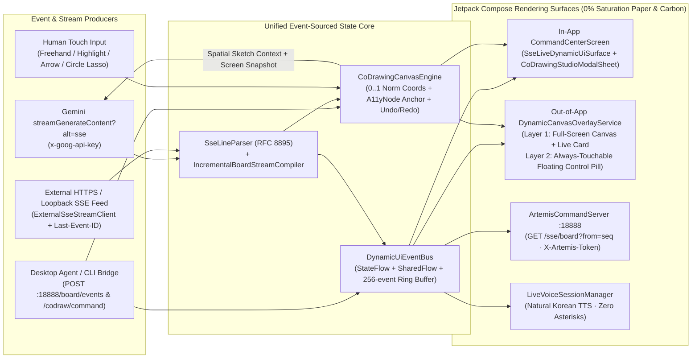
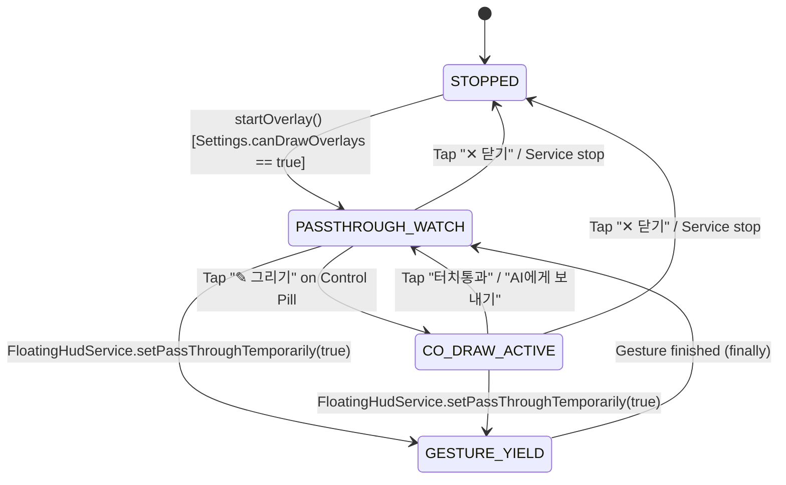

# SSE-Based Dynamic UI & Cross-App Mobile Co-Drawing Architecture (`v6.4.0`)

## 1. Design Goals

Hanson Mobile-Use `v6.4.0` extends the Ahaboard-inspired Event-Sourced Dual-Channel Board (`v6.3.0`) into a **unified real-time SSE Dynamic UI + Human/AI Co-Drawing architecture** that operates seamlessly:

1. **Inside the App (`IN_APP_BOARD`)**: Real-time token-by-token Dynamic UI rendering (streaming headlines, stat pills, numbered takeaways, interactive quiz/choice cards, checklists, karaoke voice captions) + embedded Human/AI interactive whiteboard inside `CommandCenterScreen`.
2. **Outside the App (`SYSTEM_ALERT_WINDOW` Cross-App Overlay)**: A Jetpack Compose `ComposeView` overlay (`DynamicCanvasOverlayService`) floating cleanly over any foreground Android app (KakaoTalk, Chrome, YouTube, Toss, Settings) with **non-blocking touch passthrough** and 1-tap switching into **Co-Drawing ("함께 그리기")** directly on top of live mobile UI.
3. **External Agent & Bridge Interoperability (`127.0.0.1:18888`)**: Token-authenticated SSE output stream (`GET /sse/board?from=<seq>`) and command ingress (`POST /board/events`, `POST /codraw/command`) so desktop coding/AI agents (Claude Code, Codex, Gemini CLI, Laptop CLI Bridge) can draw live UI cards and visual annotations directly on the user's phone screen.

---

## 2. End-to-End Architecture Topology



---

## 3. Dual-Channel SSE Wire Protocol

Every event delivered over `GET /sse/board` or parsed by `ExternalSseStreamClient` follows RFC 8895 (`text/event-stream; charset=utf-8`) with monotonic sequence IDs for lossless resume via `Last-Event-ID` or `?from=<seq>`:

```text
id: 42
event: tutor_command
data: {"name":"tutor_command","turnIndex":3,"orderIndex":0,"commandName":"write_headline","elementId":"title","position":{"spaceId":"soxs_etf","columnId":"main"},"eyebrow":"실시간 SSE 브리핑","text":"SOXS 최근 종가 $83.16"}

id: 43
event: tutor_command
data: {"name":"tutor_command","turnIndex":3,"orderIndex":1,"commandName":"speak","elementId":"speak_title","position":{"spaceId":"soxs_etf","columnId":"main"},"text":"SOXS 최근 종가는 83.16달러입니다.","style":"warm","linkedElementId":"title"}

id: 44
event: codraw_command
data: {"name":"codraw_command","id":"ai_ring_1","author":"AI","kind":"SPOTLIGHT_RING","nx":0.52,"ny":0.44,"radius":0.11,"label":"여기를 탭하세요","stepBadge":"1","targetElementIndex":4}

id: 45
event: ui_widget
data: {"name":"ui_widget","widgetType":"QUIZ","id":"quiz_1","question":"SOXS는 어떤 지수를 역추종할까요?","options":["필라델피아 반도체(SOX) 3배 인버스","S&P 500 2배 레버리지","나스닥 100 1배"],"correctIndex":0}
```

### LLM Inline Streaming Directives
During live LLM SSE streaming (`Gemini streamGenerateContent?alt=sse`), `IncrementalBoardStreamCompiler` incrementally parses line-delimited dual-channel directives as tokens stream in:
- `SPEAK: <natural Korean prose>` → Emits `BoardEventCommand.Speak` immediately into karaoke captions & TTS queue (never shown raw on the visual board).
- `BOARD:` → Structural separator stripped from display; subsequent lines incrementally compile into `WriteHeadline`, `AddStatPill`, `AddTakeaway`, `WriteNote`, and `AddCitation`.
- `QUIZ: <question> | <opt1> | <opt2> | <opt3> | <correctIndex>` → Emits interactive `DynamicUiWidget.QuizCard`.
- `CHECK: <step label>` → Emits interactive `DynamicUiWidget.ChecklistItem`.
- `CODRAW: RING <nx> <ny> <radius> <label>` / `CODRAW: ARROW <x1> <y1> <x2> <y2> <label>` / `CODRAW: BOX <left> <top> <right> <bottom> <label>` → Emits live AI co-drawing primitives directly onto `CoDrawingCanvasEngine`!

---

## 4. Out-of-App Dual-Window Touch-Passthrough State Machine

Hosting a full-screen Compose overlay above arbitrary Android apps requires strict touch-isolation guarantees so the user is NEVER locked out of their phone and `GestureController` never clicks our own overlay.



### Two-Window Strategy (`DynamicCanvasOverlayService`)
1. **Window 1 — Full-Screen Transparent Co-Draw & Live Dynamic UI Canvas (`MATCH_PARENT × MATCH_PARENT`)**:
   - In `PASSTHROUGH_WATCH`: uses `FLAG_NOT_FOCUSABLE | FLAG_NOT_TOUCHABLE | FLAG_LAYOUT_IN_SCREEN` (`alpha = 1f`, or `0.25f` during `GESTURE_YIELD`). Every single tap, scroll, and IME press passes directly to the underlying app while AI arrows, spotlight rings, and streaming SSE cards remain crisply visible.
   - In `CO_DRAW_ACTIVE`: removes `FLAG_NOT_TOUCHABLE` so the user's finger draws smooth Bezier strokes, highlights, arrows, or circle lassos directly over the live screen. A crisp 2dp monochrome frame border signals drawing mode is active.
2. **Window 2 — Compact Draggable Control Pill (`WRAP_CONTENT × WRAP_CONTENT`)**:
   - Always interactive (`FLAG_NOT_FOCUSABLE`, touchable) except during atomic `GESTURE_YIELD` windows.
   - Houses 1-tap mode toggle (`✎ 그리기` / `터치통과`), `보드` card collapse toggle, `AI 질문` (sends current screen + sketch regions to VLM/SSE stream), `지우기`, and `✕` exit.
3. **Compose-in-Service Lifecycle Bridge (`OverlayComposeLifecycleOwner`)**:
   - Attaches a dedicated `LifecycleRegistry`, `SavedStateRegistryController`, and `ViewModelStore` to each overlay `ComposeView` before `WindowManager.addView()`, moving lifecycle state `INITIALIZED → CREATED → STARTED → RESUMED` and cleanly tearing down to `DESTROYED` in `onDestroy()`.

---

## 5. Normalized Co-Drawing Coordinate & Accessibility Anchor Model

- All human strokes and AI vector primitives use resolution-independent normalized coordinates `(nx, ny) ∈ [0f, 1f]`:
  - `nx = (px / viewportWidth).coerceIn(0f, 1f)`
  - `ny = (py / viewportHeight).coerceIn(0f, 1f)`
- Set-of-Marks `0..1000` coordinates map losslessly via `nx = norm1000 / 1000f`.
- **A11yNode Anchor Binding**: When the AI targets an accessibility element `[element_index]`, `CoDrawingCanvasEngine.createAnchorAnnotationForNode(...)` computes the normalized bounding box `(left, top, right, bottom)` from `A11yNode.bounds` and emits an `AiSpotlightRing` or `AiHighlightBox` aligned directly on that widget.
- **Human Sketch → VLM Prompt Grounding**: `CoDrawingCanvasEngine.buildSpatialPromptSummary()` summarizes human strokes into concise normalized regions (e.g., `"사용자가 화면 (x=0.22..0.78, y=0.41..0.52) 영역에 원형 표시를 남겼습니다"`) alongside any overlapping `[element_index]` nodes from the latest accessibility snapshot, letting the VLM reason accurately over what the user circled!

---

## 6. Security & Design Invariants

- **Strict Achromatic Palette (`0%` Saturation)**: All in-app and out-of-app Compose UI uses exclusively `ObsidianColors` Paper Light & Carbon Dark tokens (luminance contrast, 1dp hairlines, solid ink callout pills, dashed vs solid stroke differentiation for Human vs AI).
- **Authenticated Loopback SSE (`:18888`)**: `GET /sse/board`, `POST /board/events`, and `POST /codraw/command` enforce constant-time `X-Artemis-Token` / `Authorization: Bearer` authentication identical to all other `:18888` routes.
- **Safe External SSE URLs**: `ExternalSseStreamClient` permits only `https://` URLs or explicit loopback `http://127.0.0.1` / `http://localhost` endpoints, rejecting cleartext remote HTTP hosts.
- **Zero Exported Overlay Surface**: `DynamicCanvasOverlayService` is declared `android:exported="false"` in `AndroidManifest.xml` and guards `Settings.canDrawOverlays(context)` before attaching windows.
